<div align="center">

<picture>
  <source media="(prefers-color-scheme: dark)" srcset="docs/hero-dark.png">
  
</picture>

[](#the-problem-and-our-solution)
[](tests/)
[](docs/chaos.md)
[](docs/eval.md)
[](#meterless-nightshift-and-nvidia-nemotron)
[](LICENSE)

**[Project site](https://hemanth-raja.github.io/shopfloor-os/)** · **[▶ Demo video (3:56, live)](https://youtu.be/YExRZBpAkTA)** · **[Slide deck](https://drive.google.com/file/d/1JJXHiZ3pP-_qGZy0m5hewZ2OqyfJNHsD/view?usp=sharing)** · **[▶ Run it in 2 minutes](#try-it-in-2-minutes)** · **[Replays](https://hemanth-raja.github.io/shopfloor-os/replay.html)** · **[Evaluation](docs/eval.md)** · **[Live run trace](docs/live-run/README.md)** · **[Production review](docs/production-readiness.md)**


**For judges:** [Zetaris](docs/sponsors/ZETARIS.md) (USL, live queries, data quality rule, hand-coded comparison) · [Meterless](docs/sponsors/METERLESS.md) (3 engines, Nightshift, signed receipts) · [NVIDIA Nemotron](docs/sponsors/NVIDIA.md) (model per role, per-call evidence) · [Cursor](docs/sponsors/CURSOR.md)

</div>

## Contents

[What it is](#what-is-shop-floor-os) · [Problem](#the-problem-and-our-solution) · [How it works](#how-it-works) · [Results](#results-at-a-glance) · [Examples](#sample-incidents) · [Try it](#try-it-in-2-minutes) · [Usage](#usage) · [Sponsor technology](#sponsor-technology) · [Reliability](#reliability-and-safety) · [Limitations](#limitations) · [Disclosure](#disclosure) · [Team](#team)

## What is Shop-Floor OS?

When something goes wrong on a car assembly line (a part doesn't arrive, a robot cart breaks down, coolant spills), a supervisor has seconds to decide who to send and whether it's safe. **Shop-Floor OS helps make that decision.**

1. **It reads the factory data** from four separate systems at once (Zetaris).
2. **AI suggests what to do** (NVIDIA Nemotron, through Meterless Nightshift).
3. **Plain code checks every suggestion** against OSHA safety rules and tests it in a simulation before anything moves.
4. **A person approves** anything risky.

In one sentence: *the AI suggests, code checks, and a person approves the risky ones.* Everything runs on a simulated factory, so no real equipment is involved.

**Who it is for:** shift supervisors, team leaders and maintenance planners in vehicle assembly.

**Why it fits Track 3:** it turns data (Zetaris), knowledge (World Model, OSHA clauses), memory (H-MEM) and
reasoning (Nemotron) into decisions and actions that are checked, simulated, gated and verified.

## The problem and our solution
<picture>
  <source media="(prefers-color-scheme: dark)" srcset="docs/problem-solution-dark.png">
  
</picture>

## Results at a glance
| Area | Result |
|---|---|
| **The rule that matters** | Nemotron proposes; code decides what is safe. Every plan passes a deterministic OSHA critic, a simulated dry run and a restraint gate, and a person approves anything that sends someone into a hazard |
| **Safety, measured** | 0 unsafe plans executed. The critic caught 216 of 216 planted unsafe plans and wrongly rejected 0 of 54 safe ones; live, Nemotron's first plan (3.5 Super VL as the planner) broke a rule in 6 of 27 calls and fixed all 6 after the critic's feedback ([docs/eval.md](docs/eval.md)) |
| **Fewer false dispatches** | The Monitor sent 19 false alarms to the floor where a plain threshold alarm sends 235 (600 noisy alarms, Brier 0.096 vs 0.392) |
| **Failure-tested** | 15 chaos scenarios (a model down, Nightshift down, 60% of calls failing, broken JSON, a different model answering, Zetaris down…) plus a 19-incident shift on flaky models: every one ends in a decision, nothing unsafe runs ([docs/chaos.md](docs/chaos.md)) |
| **Every model call, signed** | Three NVIDIA Nemotron models, each pinned to its own Nightshift app; every call records the requested and the answering model, and 6,215 of 6,215 Ed25519 receipts verify (`run.py receipts --verify`, 26 Oct 2026) |
| **Data** | Four sources federated by Zetaris and modelled as one Unified Semantic Layer; the agents read it on their own read-only login, so a write from an agent is refused by Zetaris itself |
| **Runs without us** | `SAMPLE_MODE=true` runs the real agent loop offline, with no keys, Zetaris or Nightshift |

## How it works
Four agent teams share one data layer, one model gateway and one set of deterministic safety checks.


<sub>Source: [docs/architecture.html](docs/architecture.html).</sub>

### How the agents work together
There is no fixed pipeline. In an incident, the orchestrator sits in the middle and picks the next agent among the
moves that code allows; agents send work back when a check fails. Every arrow is labelled with the condition that
sends work along it. Code: [`app/dynamic.py`](app/dynamic.py) (legal moves), [`app/autonomy/`](app/autonomy),
[`app/investigate/`](app/investigate), [`app/lab/`](app/lab). Details: [How an incident is handled](docs/agents.md#how-an-incident-is-handled-a-dynamic-orchestrator).

<details>
<summary><b>Agent flow diagrams (incident response hub and the other three teams)</b></summary>

**Incident response: a hub with feedback loops**

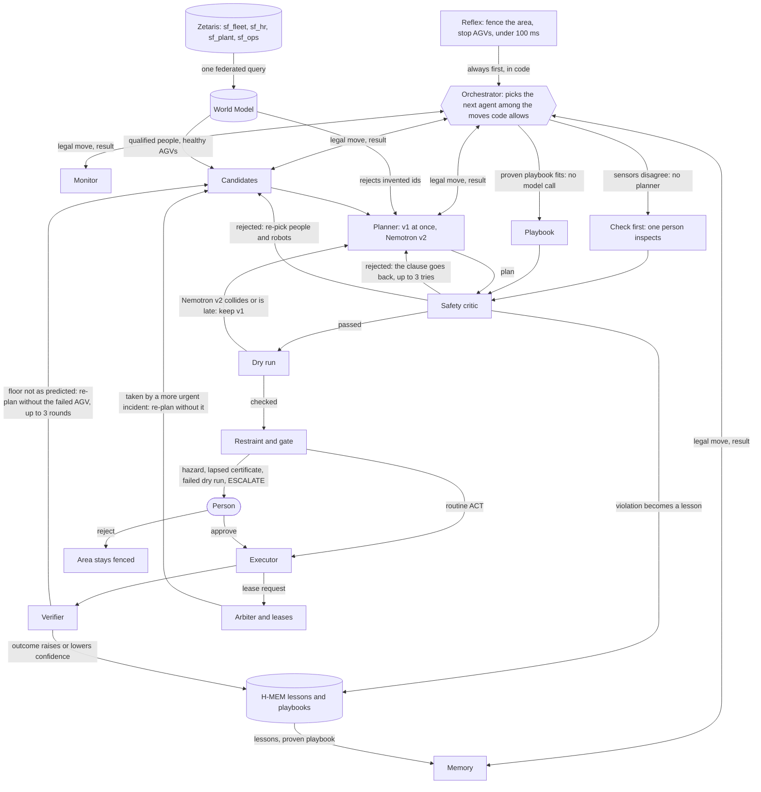

**The other three teams, each its own loop**

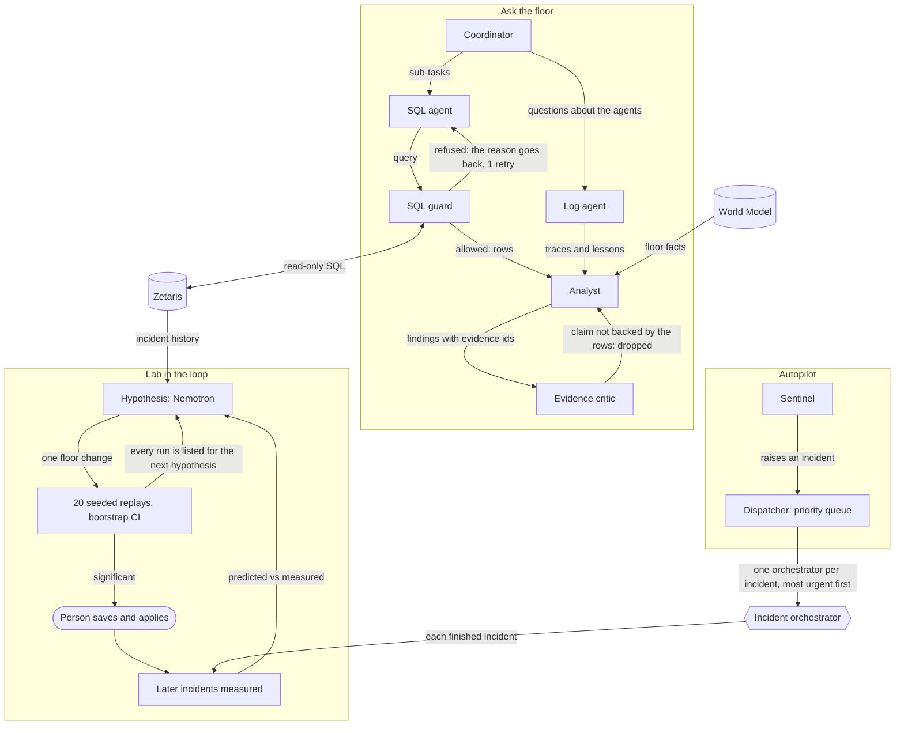

</details>

### Every agent

<details>
<summary><b>Table of all 12 agents, their roles, models, and blocking/retry behaviour</b></summary>

| Agent | Role | Model | Can block or retry? | Sends work back to |
|---|---|---|---|---|
| reflex | Geofences the incident and stops or re-routes AGVs, in under 100 ms | none (rules) | Acts first; cannot be skipped | Nobody: it acts first and nothing returns to it |
| monitor | Real alarm or sensor noise, from thresholds plus Bosch vibration evidence; one-line summary | `monitor` role (summary only) | Yes: noise sends one person to check instead of a dispatch | *Check first* (one person inspects) instead of the planner, when the sensors disagree |
| memory | Recalls H-MEM lessons from past incidents before planning | none (H-MEM ranking) | No | The playbook step, skipping the planner, when a proven playbook fits |
| candidates | Top-3 qualified workers and healthy AGVs from the World Model (valid certifications; no service-overdue AGV for critical work) | none | Yes: only certified people and healthy AGVs get through | Nobody directly; with no qualified person or healthy AGV the incident ends in ESCALATE |
| planner | Chooses among the candidates; strict JSON; must cite the governing clauses | `planner` role | Retries up to 3 times with the critic's clauses | The critic, with every new version |
| safety critic | Deterministic OSHA-based rule engine; cites the exact clause per violation; the planner gets up to 3 tries. Rules include lockout/tagout and robot-cell entry (robot-cell faults, overheats), torque re-audit (torque faults), the held AGV and supervisor sign-off (near misses) and inspector containment (quality defects) | none | Yes: blocks any plan that breaks a rule, with the clause | The planner with the clause (up to 3 tries), or candidates to re-pick; after 3 tries, restraint |
| dry-run | 60 s headless simulation with A* and a reservation table; fails on a collision or a late ETA | none | Yes: a collision or late ETA fails the plan | Refine keeps v1 when Nemotron's v2 collides or is late; a failed v1 goes to restraint, which holds or escalates to a person |
| restraint | ACT, VERIFY, SAFE_HOLD, ESCALATE or DO_NOTHING, from confidence, sensor agreement and cost | none | Yes: can hold, verify or escalate instead of acting | A person, through the gate, for VERIFY, SAFE_HOLD, ESCALATE or a hazard |
| executor / verifier | Dispatches in the sim and checks the world changed as predicted; re-plans on mismatch | none | Yes: a mismatch triggers a re-plan | Candidates without the failed AGV (up to 3 rounds); the arbiter re-plans when a lease is lost |
| health | Circuit breakers for Zetaris and Nightshift; safe mode when Nightshift is down | none | Yes: opens breakers and switches to safe mode | Safe mode instead of the planner when Nightshift is down |
| lab | Policy hypothesis, then 20 seeded replays (no LLM), then a bootstrap 95% CI | `lab` role (hypothesis only) | Only proposes; a person applies | A person, who saves and applies the change; later incidents measure it for the next hypothesis |
| orchestrator | Chooses the next agent at each decision point, within the legal moves (see below) | `router` role | Routes only among legal moves; code overrides an illegal pick | Any legal agent; an illegal pick goes to the rule-based router |

</details>

### What makes this an agent system

<details>
<summary><b>Agent patterns and where to look in code and traces</b></summary>

| Pattern | Where it happens |
|---|---|
| **Dynamic delegation** | The orchestrator picks the next agent hop by hop; the router model chooses only among the moves code allows, so incidents take different routes ([`output_examples/`](output_examples)) |
| **Critique loop** | The safety critic rejects a plan with the OSHA or SOP clause; the planner gets the clause and tries again (up to 3 times); the evidence critic drops any claim the cited rows do not back |
| **Retry logic** | Model calls retry with backoff, then the next model; a refused SQL query goes back with the guard's reason for one retry; a stalled AGV makes the verifier re-plan |
| **Shared state** | All agents read and write one incident state and the Meterless World Model built from one federated Zetaris query; H-MEM is shared memory across incidents |
| **Escalation** | No playbook, no qualified person, a lapsed certificate or a failed model chain ends in ESCALATE or SAFE_HOLD, and a person decides |
| **Role authority** | The critic, dry run and human gate can block dispatch; nothing reaches the floor without passing all three |
| **Non-linear flow** | Branches on alarm confidence (VERIFY vs ACT), risk (human gate), resources taken by another incident (arbiter) and the world not changing as predicted (re-plan) |

**Where to look.** Agent decisions: `output.path` in every response, with who chose each hop and why. Zetaris:
[`app/zetaris.py`](app/zetaris.py) and the `sql` and `candidates` steps. Meterless: [`app/engines/`](app/engines) and
the `memory`, `candidates` and handover steps. Retries and feedback: `status: needs_revision`, `retry_count` and
`replans` in the trace. Fallback to sample data: `SAMPLE_MODE=true`. Logs: [`logs/`](logs) and stdout. The final
answer: the `restraint` and `gate` steps, returned as `output.decision`.

</details>

## Lab in the loop: test a floor change, apply it, measure it
<picture>
  <source media="(prefers-color-scheme: dark)" srcset="docs/loop-dark.png">
  
</picture>

<sub>Read it clockwise. A model proposes, the agents try the idea on a digital twin of the hall before anything real
moves, the Lab tests changes against history, and what was learned flows back to the model. A person sits on two
edges: approving risky plans before the twin's result reaches the floor, and saving a Lab proposal. Source:
[docs/loop.html](docs/loop.html).</sub>

The incident loop learns from each incident (H-MEM lessons). The Lab asks a slower question: would changing the
floor itself make a whole class of incidents shorter?


<sub>Source: [docs/learning-loops.html](docs/learning-loops.html).</sub>

<details>
<summary><b>How one experiment runs</b></summary>

One *Run experiment* (`run.py lab`, the *Lab* tab):
1. **Reads history.** One Zetaris query summarises past spills and part shortages per station: count, mean time to
   clear, and the walking distance to the nearest spill kit or to the parts supermarket.
2. **Proposes a change.** Nemotron (the `lab` role) reads the summary, plus the runs already tested and what an
   applied change measured, and proposes one testable change: a spill kit at a station, or a loaded AGV waiting at
   one. With Nemotron down, a rule picks the busiest station, and the page says so in red.
3. **Re-scores history.** Every real incident of that kind is re-walked with A* on the floor grid, with and without
   the change; only the travel part of its clear time changes.
4. **Replays and measures.** 20 seeded replays and 2,000 bootstrap resamples give the change in mean time to
   clear with a 95% interval. No model runs inside the replays, so the same run gives the same answer.
5. **Apply and measure.** A significant result can be saved to Zetaris (`sf_ops.experiments`) and applied to the
   floor: the map shows it, and every later incident of that kind is measured with and without it
   ([`app/lab/loop.py`](app/lab/loop.py)), predicted saving next to measured. *Remove the change* takes it off; both survive a restart.

</details>

## Sample Incidents:
Screenshots from the real web UI in sample mode (`SAMPLE_MODE=true python -m app.server`, no keys), taken on
26 Oct 2026. Each incident graph is the route the orchestrator took: numbered arrows in the order taken, and
arrows going back where work was returned. The hop tables come from `output.path` in the JSON output. The UI
runs with H-MEM memory on, so its graphs have one extra `memory` hop that the JSON examples (memory off) do not.

### Incident 1: part shortage at F30, where the critic stops Nemotron's plan
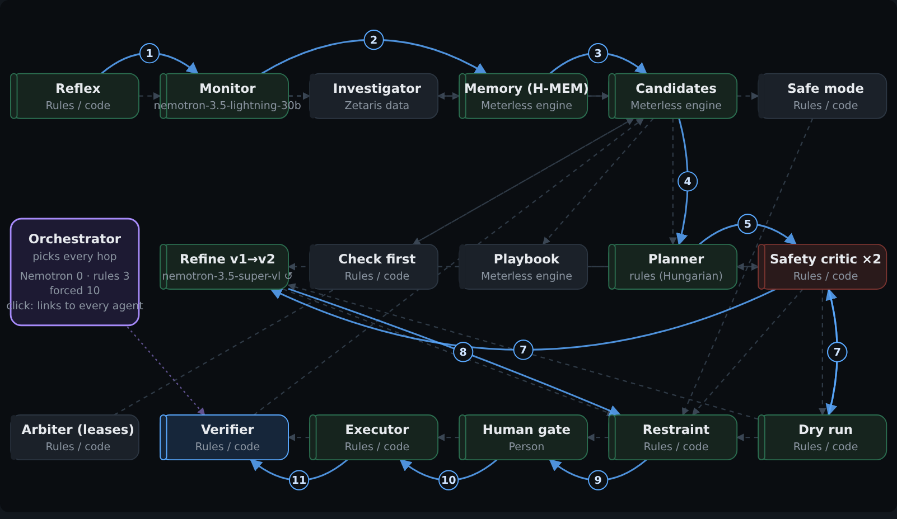

**What happened.** A kit is short at F30. The planner's rules plan (v1: worker W-18 and AGV-5, 0.5 m/s at
crossings) is ready at once. Nemotron's recorded plan (v2) sends AGV-5 through the X-WEST crossing at 1.0 m/s. The
safety critic rejects v2 under 29 CFR 1910.178(n)(4), refine keeps v1, the routine plan runs on its own, and the
verifier sees the floor move as predicted. **ACT, auto-executed.**

| Hop | Agent | Chosen by | Work sent back? |
|---|---|---|---|
| 0 | reflex | code (always first) | |
| 1 | monitor | forced (only legal move) | |
| 2–3 | candidates, planner | rules router | |
| 4–5 | critic, dry run (on v1) | forced | v1 passes both |
| 6 | refine | forced | **yes: the critic rejects Nemotron's v2 (R-CROSSING); v2 is dropped, v1 kept** |
| 7–10 | restraint, gate, executor, verifier | forced | |

**Output: what changed on the floor.**
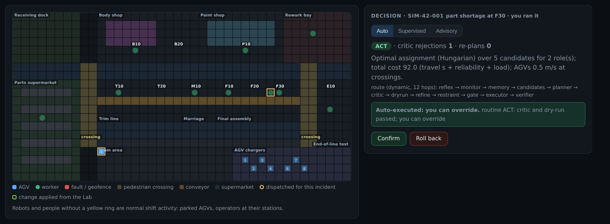

- **Decision:** ACT, run on its own (a routine plan that passed the critic and the dry run; a person can roll it back).
- **Dispatched:** team leader W-18 to F30 (there in 4 s) and kitting AGV-5 with the parts (112 s), at 1.0 m/s and
  slowing to 0.5 m/s at the X-WEST crossing, the rule Nemotron's rejected plan broke.
- **Checked:** the dry run found 0 collisions, and the verifier saw everyone move as predicted. Waiting would have
  cost about $5,082, acting about $42.

Input: [`input_examples/example_1.json`](input_examples/example_1.json) · Output: [`output_examples/example_1.json`](output_examples/example_1.json) · All 8 explained: [output_examples/README.md](output_examples/README.md)

### Incident 2: AGV-3 fault and a stall, where the verifier re-plans
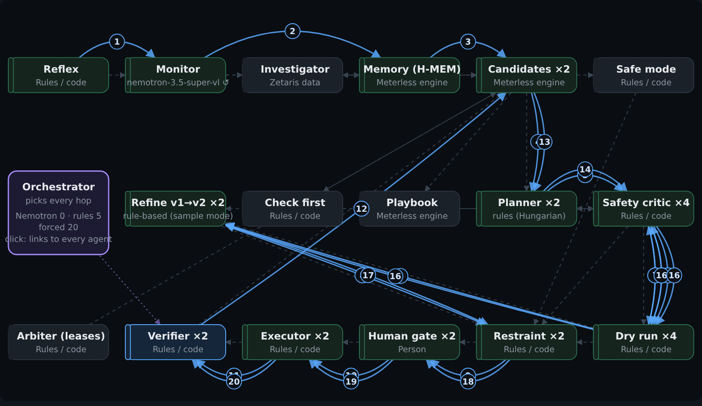

**What happened.** AGV-3 faults on the way to F30. The first plan sends AGV-1, which stalls mid-route. The verifier
sees AGV-1 five cells short of where it should be and sends the work back to candidates without AGV-1. The second
round sends AGV-2 and the verifier confirms it. **ACT, 1 re-plan.**

| Hop | Agent | Chosen by | Work sent back? |
|---|---|---|---|
| 0–1 | reflex, monitor | code, forced | |
| 2–3 | candidates, planner | rules router | |
| 4–9 | critic, dry run, refine, restraint, gate, executor | forced | |
| 10 | verifier | forced | **yes: AGV-1 stalled; back to candidates without it** |
| 11–12 | candidates, planner | rules router ("re-pick people and robots without the ones that failed") | |
| 13–19 | critic, dry run, refine, restraint, gate, executor, verifier | forced | |

**Output: what changed on the floor.**
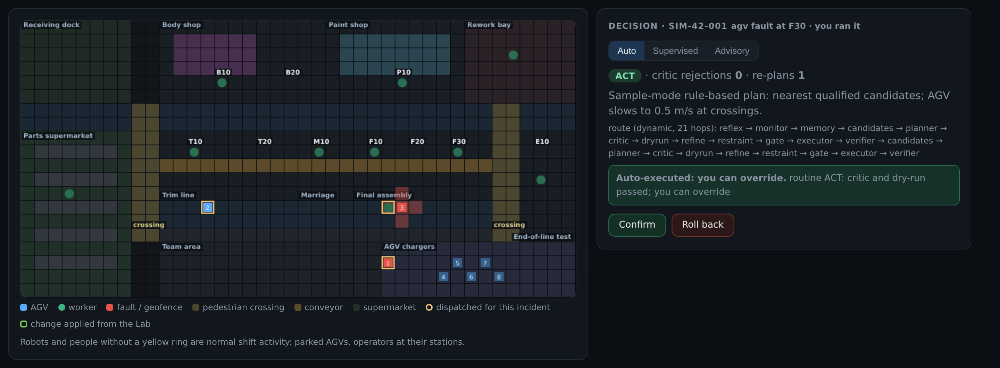

- **Decision:** ACT, after 1 re-plan, run on its own.
- **What happened on the floor:** the reflex fenced 5 cells around AGV-3. AGV-1 was sent with the parts and stalled
  5 cells short of where it should have been; the verifier caught it, AGV-1 was taken out of service, and AGV-2
  went instead (108 s), with W-18 at F30 (28 s).
- **Checked:** 0 collisions; the second round's verifier saw the floor change as predicted.

Input: [`input_examples/example_2.json`](input_examples/example_2.json) · Output: [`output_examples/example_2.json`](output_examples/example_2.json) · All 8 explained: [output_examples/README.md](output_examples/README.md)

### Incident 3: overheat at F10 that is sensor noise, where nothing is dispatched
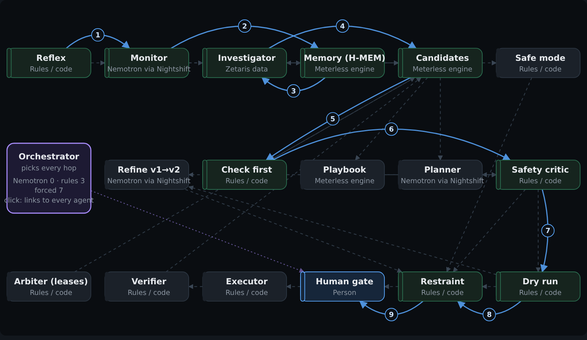

**What happened.** The temperature is over its threshold, but the Bosch vibration recording is normal, so the
sensors disagree. The router sends the incident to the investigator (history first), then to *check first*: one
qualified person inspects. No planner and no model call. **VERIFY; the line keeps running and a person confirms.**

| Hop | Agent | Chosen by | Work sent back? |
|---|---|---|---|
| 0–1 | reflex, monitor | code, forced | |
| 2 | investigator | rules router ("the alarm is ambiguous: look at the history before planning") | |
| 3 | candidates | forced | |
| 4 | check first (`verify_plan`) | rules router ("sensors disagree: one person checks first, no planner needed") | |
| 5–7 | critic, dry run, restraint | forced | |
| 8 | gate | forced | **waits for a person** |

**Output: what changed on the floor.**
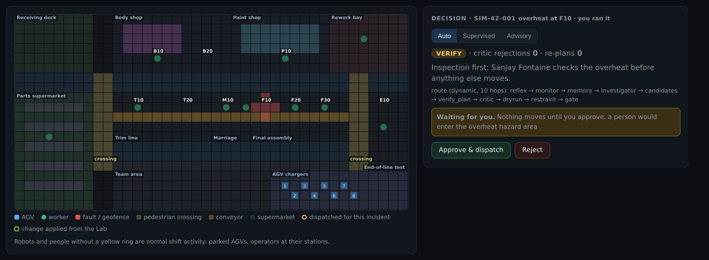

- **Decision:** VERIFY. The line keeps running; nothing is dispatched until a person approves.
- **Why:** the monitor put the alarm at p = 0.20 (process temperature 315.1 K against a 313.0 K threshold, but the
  Bosch vibration recording is normal), and the investigator found 1 of the last 3 overheats at F10 was a false
  alarm. The expected cost of acting now was about $15,042, against $1,800 for checking first.
- **Next:** maintenance technician W-19 (in-date lockout/tagout) inspects F10, 36 s away, once a person approves,
  because the check means entering the overheat area. No AGV moves and no collisions.

Input: [`input_examples/example_3.json`](input_examples/example_3.json) · Output: [`output_examples/example_3.json`](output_examples/example_3.json) · All 8 explained: [output_examples/README.md](output_examples/README.md)

### Sample inputs and outputs
Examples 1 to 3 are shown above with their screenshots. The other five, each a different incident kind, run the same way (`run.py run input_examples/example_N.json`); [output_examples/README.md](output_examples/README.md) explains all eight in plain English.

| Input | What happens | Output |
|---|---|---|
| [`input_examples/example_4.json`](input_examples/example_4.json): coolant spill at F20 | A two-cell geofence goes up and AGVs stay out. The spill responder goes in, citing 29 CFR 1910.22. Result: ACT | [`output_examples/example_4.json`](output_examples/example_4.json) |
| [`input_examples/example_5.json`](input_examples/example_5.json): robot-cell fault at B10 (weld robots) | The cell is fenced. Only a technician with in-date lockout/tagout and a robot-cell card may enter (29 CFR 1910.147, SOP-ROBOT-02). ACT, but it waits for a person to approve | [`output_examples/example_5.json`](output_examples/example_5.json) |
| [`input_examples/example_6.json`](input_examples/example_6.json): nutrunner torque fault at F10 | v1 sends a tool technician and the torque auditor. Nemotron's v2 sends only the technician; the critic rejects it (SOP-TORQUE-01: joints since the last good torque must be re-audited), so v1 stays. A single NOK with `false_alarm` gives VERIFY | [`output_examples/example_6.json`](output_examples/example_6.json) |
| [`input_examples/example_7.json`](input_examples/example_7.json): pedestrian near miss at F30 | The AGV involved is held where it stopped; a supervisor with incident command secures the scene. A safety event, so a person signs off | [`output_examples/example_7.json`](output_examples/example_7.json) |
| [`input_examples/example_8.json`](input_examples/example_8.json): quality defect at end-of-line | A quality inspector contains the affected units (SOP-QUAL-01). Routine, auto-executed | [`output_examples/example_8.json`](output_examples/example_8.json) |

### Sample Example - Ask the floor
Code: [`app/investigate/`](app/investigate). A question is handled by a team of agents; nothing on the floor moves. In sample mode only these three questions replay recorded Nemotron replies (see [What sample mode covers](#what-sample-mode-covers)).

| | |
|---|---|
| 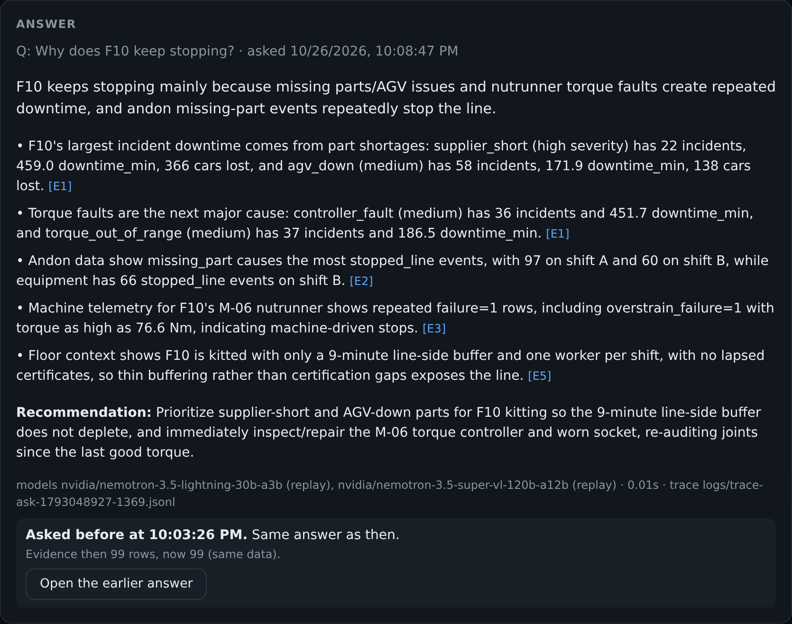 | **"Why does F10 keep stopping?"** The coordinator splits the question into three SQL tasks over `sf_ops.incidents` (27 rows), `sf_ops.andon_events` (17) and `sf_plant.machine_telemetry` (47); the log agent adds the agents' own history and the World Model adds floor facts. Five findings, each citing its evidence; the critic drops none. Answer: part shortages and nutrunner torque faults. |
| 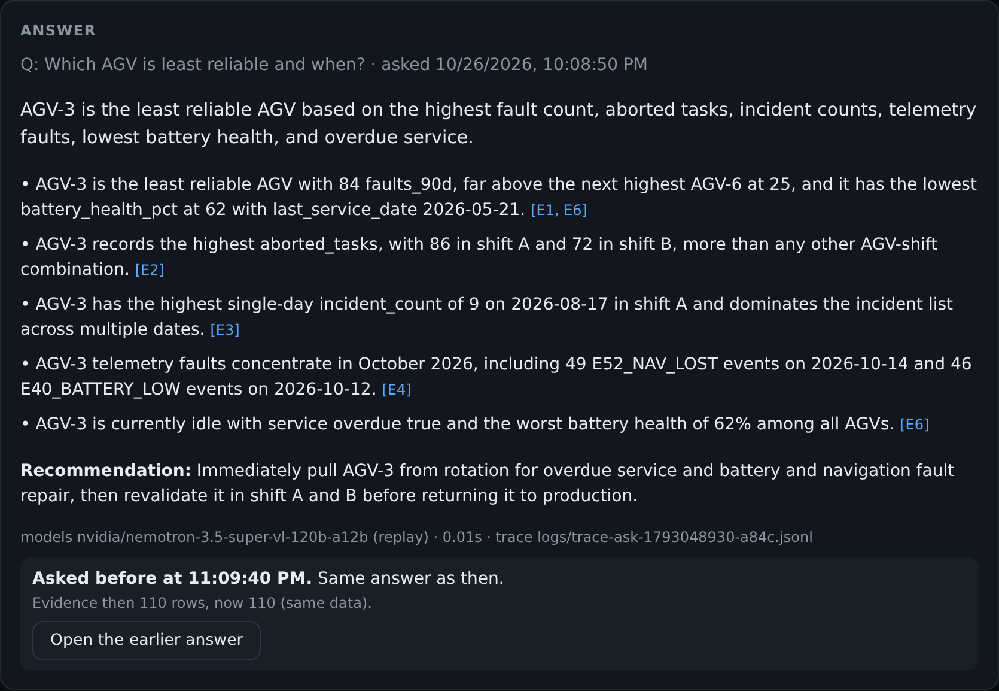 | **"Which AGV is least reliable and when?"** Four SQL tasks (three on `sf_fleet`, one on `sf_ops.incidents`) plus logs and floor facts. AGV-3 has 84 faults in 90 days against 25 for the next AGV, the lowest battery health (62%) and overdue service. Recommendation: pull AGV-3 for service. |
| 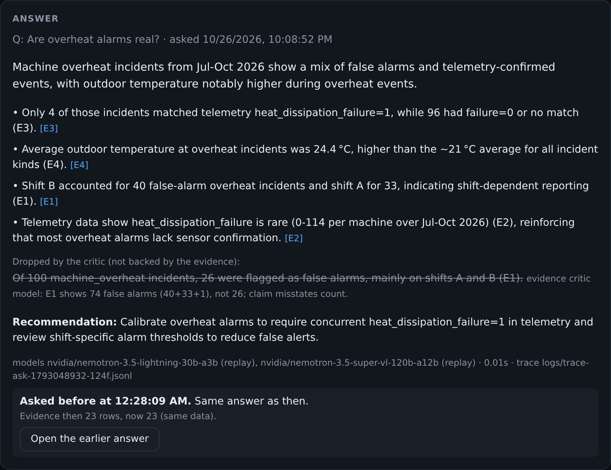 | **"Are overheat alarms real?"** Four SQL tasks across `sf_ops.incidents` and `sf_plant.machine_telemetry`, one joining both. The analyst wrote five claims; **the evidence critic dropped one** ("26 false alarms") because the cited rows show 74. Answer: only 4 of 100 overheat incidents match a telemetry heat failure. |

Agents called for *"Are overheat alarms real?"* (from its trace):

| Agent | What it did | Model |
|---|---|---|
| intake | classified it as a plant question | rules |
| coordinator | split it into 5 sub-tasks | Nemotron 3.5 Super VL |
| SQL agent ×4, SQL guard, Zetaris | 4 read-only queries over `sf_ops.incidents` and `sf_plant.machine_telemetry` (5, 8, 8 and 2 rows), run in parallel | Nemotron 3.5 Super VL |
| log agent | searched the agents' traces and model calls, alongside the SQL | none |
| analyst | wrote 5 findings, each citing its evidence | Nemotron 3.5 Lightning |
| evidence critic | kept 4, struck out 1 ("26 false alarms": the rows show 74) | rules, then Nemotron 3.5 Lightning |

### Sample Example - Lab: Proposed by Nemotron
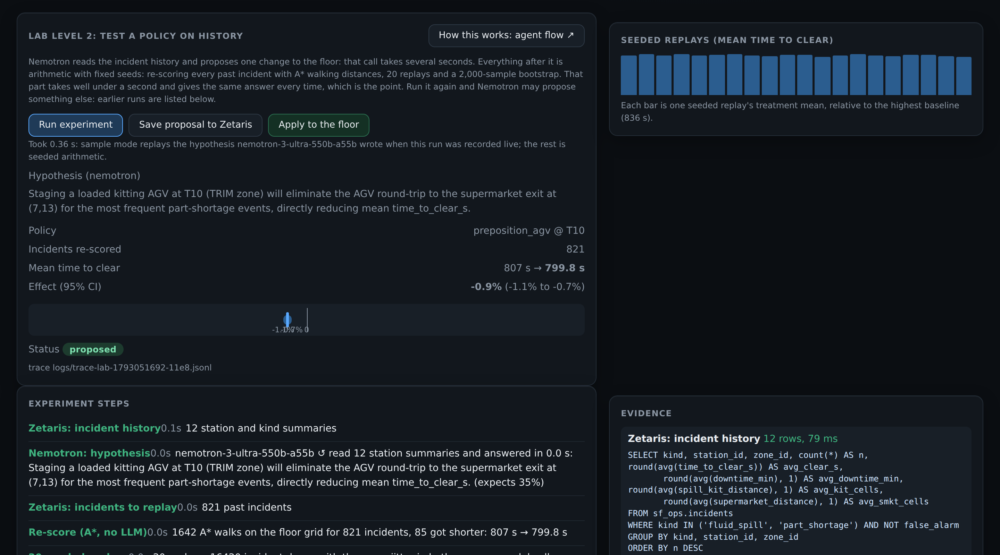

**What happened.** Nemotron 3 Ultra 550B read the per-station history of spills and part shortages and proposed one
change: *stage a loaded kitting AGV at T10*, so part shortages there skip the trip to the supermarket. Code then
tested it on history with no model: all 821 past part shortages re-walked with A* with and without the change, 20
seeded replays and a 2,000-sample bootstrap. **Mean time to clear 807 s → 799.8 s, -0.9% (95% CI -1.1% to -0.7%):
small but significant, status *proposed*.** A person decides whether to save it to Zetaris and apply it to the
floor; later part shortages are then measured against the prediction. This run was recorded live through Nightshift
on 26 Oct 2026 (Ultra answered in 2.9 s), and sample mode replays that reply, so the same run appears offline.

An earlier live run, shown in the slide deck, proposed a loaded kitting AGV at F10: -7.2% time to clear (95% CI -8.0% to -6.4%). Nemotron's proposal differs between runs; the Lab tests each one on history before anyone applies it.


| Step | Agent | What it did in this run | Model |
|---|---|---|---|
| 1 | history | one Zetaris query: 12 station and kind summaries | none |
| 2 | hypothesis | "stage a loaded kitting AGV at T10" | Nemotron 3 Ultra 550B |
| 3 | incidents | 821 past part shortages to replay | none |
| 4 | re-score | 1,642 A* walks; 85 incidents got shorter | none |
| 5 | replays, bootstrap | 20 seeded replays, 2,000 resamples: -0.9% (95% CI -1.1% to -0.7%), significant | none |
| 6 | a person | *Save proposal to Zetaris*, *Apply to the floor* | – |

## Outputs: what a run returns and writes
Every run returns one JSON result and writes a trace, so a person can check afterwards what the agents did and why.

<details>
<summary><b>Request and response format</b></summary>

Request:
```json
{"run_id": "example-2",
 "input": {"kind": "agv_fault", "agv": "AGV-3", "station": "F30", "stall_after": 2, "seed": 42},
 "options": {"sample_mode": false, "memory": false}}
```
- `input.kind` is one of `part_shortage`, `agv_fault`, `overheat`, `spill`, `robot_cell_fault`, `torque_fault`,
  `near_miss` or `quality_defect`. All eight run through the full loop. A kind without a response playbook would be
  fenced and escalated to a supervisor with the reason, instead of being planned.
- Optional `severity` (`low`, `medium`, `high`, `critical`) and `note` (free text from the reporter).
- `station` is a station id (B10, B20, P10, T10, T20, M10, F10, F20, F30, E10).
- `false_alarm` makes an overheat sensor noise.
- `stall_after` stalls the dispatched AGV mid-route.

Or over HTTP (`SAMPLE_MODE=true python -m app.server`, or the Docker image):
```bash
curl -X POST http://localhost:8000/run -H "Content-Type: application/json" -d @input_examples/example_1.json
```

Response (abridged from `example_1`):
```json
{"run_id": "example-1", "status": "success",
 "output": {"decision": "ACT", "score": 0.942,
            "summary": "part shortage at F30: ACT, Optimal assignment (Hungarian) over 5 candidates for 2 role(s) ...",
            "reasons": ["p_real=0.95", "sensors agree=True", "expected cost of waiting $5,082 vs acting $42"],
            "plan": {"assignee_ids": ["worker:plant:W-18", "agv:plant:AGV-5"],
                     "agv_routes": [{"agv_id": "agv:plant:AGV-5", "to_station": "F30", "speed_mps": 1.0,
                                     "crossing_speed_mps": 0.5}]},
            "citations": [{"ref": "SOP-KIT-01 §3"}, {"ref": "29 CFR 1910.178(n)(8)"}],
            "critic_rejections": 1, "gate": "auto_executed", "collisions": 0,
            "path": [{"hop": 0, "agent": "reflex", "by": "code"}, {"hop": 1, "agent": "monitor", "by": "forced"}, "..."]},
 "models": ["nvidia/nemotron-3.5-lightning-30b-a3b", "nvidia/nemotron-3.5-super-vl-120b-a12b", "rules (Hungarian)"],
 "trace_id": "trace-example-1", "log_file": "logs/trace-example-1.jsonl", "execution_time_seconds": 0.03}
```

The response contains:
- `status`;
- `output`: decision, score, reasons, plan, citations, critic_rejections, replans, safe_mode, collisions;
- `agents`, with their roles;
- `models`, naming which model handled each request;
- `trace_id`, `log_file` and `execution_time_seconds`.

Failures return `status: "error"` with a typed `error` (`InvalidInput`, `UpstreamUnavailable`, and so on) rather
than a crash.

</details>

<details>
<summary><b>Logs and traces: what every run writes, with a real excerpt</b></summary>

**Watch it live:**
- **Incidents tab** in the web UI: every incident, running ones first, with its agent flow drawn as a graph (numbered hops, who chose each hop and why) and its full history: each agent's input and output, what was sent to Nemotron, the model that answered and the latency, approvals and timeouts.
- **`python run.py watch`** in a second terminal: one coloured, plain-English line per agent step, Nemotron call and human judgement, for example `12:03:04 PLANNER  1.2s  Nemotron-Super attempt 2 -> send W-18; AGV-5->F30 1.0/0.5 m/s`.

Every run writes `logs/trace-<run_id>.jsonl`, one JSON object per agent step. Each record has the agent, ok,
timing, inputs and outputs, critic violations with clauses, the model that answered, and retries and re-plans.
Every record also carries the standard fields `trace_id`, `agent_name`, `action`, `input_summary`,
`output_summary`, `from_agent`, `target_agent`, `confidence`, `retry_count` and `status`
([`app/tracefmt.py`](app/tracefmt.py)), and every step is printed as an `[INFO]` line on stdout. From
`example_1`, the critic stopping Nemotron's plan:
```jsonl
{"trace_id": "trace-example-1", "agent_name": "planner", "action": "write_plan", "input_summary": "part_shortage at F30", "output_summary": "v1 plan: send W-18, AGV-5; AGVs AGV-5->F30; cites 2 clause(s)", "from_agent": "candidates", "target_agent": "critic", "confidence": null, "retry_count": 0, "status": "success"}
{"trace_id": "trace-example-1", "agent_name": "critic", "action": "check_safety", "input_summary": "part_shortage at F30; checks the nemotron v2 plan", "output_summary": "v2 rejected: R-CROSSING; the plan goes back with the clauses", "from_agent": "dryrun", "target_agent": "refine", "confidence": null, "retry_count": 0, "status": "needs_revision"}
{"trace_id": "trace-example-1", "agent_name": "refine", "action": "compare_plans", "input_summary": "part_shortage at F30", "output_summary": "kept v1: v2 broke R-CROSSING", "from_agent": "critic", "target_agent": "restraint", "confidence": null, "retry_count": 0, "status": "success"}
{"trace_id": "trace-example-1", "agent_name": "restraint", "action": "decide", "input_summary": "part_shortage at F30", "output_summary": "ACT (score 0.942)", "from_agent": "refine", "target_agent": "gate", "confidence": 0.942, "retry_count": 0, "status": "success"}
```

Other logs:
- `logs/llm.jsonl` records every Nightshift request with the requested and answering model and the latency.
- `logs/world_model.jsonl` records World Model builds.
- `logs/approvals.jsonl` records human judgements.

None of them contain secrets.

A real live-mode trace: [docs/live-run/](docs/live-run/README.md) holds incident `SIM-42-008` (part shortage at F30,
the critic rejecting Nemotron Ultra's v2 plan) as recorded live on 26 Oct 2026, with its four Nightshift calls and receipts.

</details>

## Try it in 2 minutes

No accounts, keys, Zetaris or Nightshift needed. Every step below runs offline with `SAMPLE_MODE=true` and,
unless noted, finishes in under a second (timed on 26 Oct 2026 in a fresh venv).

**What is replayed and what is computed.** Where a step needs Nemotron, sample mode replays a recorded Nemotron
reply from [`logs/fixtures/`](logs/fixtures) (128 files) when one exists for that exact input. Otherwise a
deterministic rule-based stand-in answers, and the output says so (`rule-based`). Everything else runs for real:
reflex, monitor, candidates, critic, dry run, restraint, gate, executor, verifier, SQL guard, Sentinel, leases,
Lab replays and the Markovian chunking.

**Requirements: Python 3.11 or newer.** Check with `python3 --version`. On macOS the default `python3` is 3.9,
which is too old; run `brew install python@3.12` and use `python3.12` in the commands below. If your `python3`
is already 3.11 or newer, you can use it as is. No suitable Python? Use Docker instead:
`docker build -t shopfloor-os . && docker run --rm -p 8000:8000 shopfloor-os`, then open http://127.0.0.1:8000.

**Clone and install.**

```bash
git clone https://github.com/Hemanth-Raja/shopfloor-os.git && cd shopfloor-os
python3.12 -m venv .venv && .venv/bin/pip install -r requirements.txt
.venv/bin/python --version    
```

1. **One incident, JSON in and out.**
   ```bash
   SAMPLE_MODE=true .venv/bin/python run.py run input_examples/example_1.json --out result.json
   ```
   stdout shows one `[INFO]` trace line per agent step, then the JSON result; `--out` also writes the JSON alone
   to `result.json`. A bad request returns `"status": "error"` with a message, and exit code 1.
   A part shortage at F30. The rules plan is ready at once; Nemotron's recorded plan sends AGV-5 through a
   pedestrian crossing at 1.0 m/s, the critic rejects it under 29 CFR 1910.178(n)(4), and the safe plan runs.
2. **All eight examples.**
   ```bash
   mkdir -p out && for f in input_examples/*.json; do SAMPLE_MODE=true .venv/bin/python run.py run "$f" --out "out/$(basename "$f")" > /dev/null; done; ls out
   ```
   Eight JSON files in about 10 s, one per incident kind, each on its own route: the critic rejects Nemotron's plan (1, 6), the
   verifier re-plans after a stall (2), a false alarm ends in VERIFY with no planner (3), a person must approve a
   hazard (4, 5, 7), and routine work runs on its own (8). See [Sample inputs and outputs](#sample-inputs-and-outputs).
3. **Ask the floor.**
   ```bash
   SAMPLE_MODE=true .venv/bin/python run.py ask "Why does F10 keep stopping?"
   ```
   Prints the investigation steps, five cited findings and the SQL behind each. Only the three questions on the UI
   buttons are recorded; any other question gets a rule-based summary of fixed queries, not a real answer.
4. **Autopilot shift.**
   ```bash
   SAMPLE_MODE=true .venv/bin/python run.py shift --minutes 2 --seed 7
   ```
   The Sentinel raises 5 incidents from 66 signals, up to 3 run at once, 4 resolve on their own and 1 waits for a
   person, 0 runtime-invariant violations.
5. **Lab.**
   ```bash
   SAMPLE_MODE=true .venv/bin/python run.py lab
   ```
   Nemotron 3 Ultra's recorded hypothesis (a loaded AGV staged at T10), 821 past part shortages re-scored, 20 seeded
   replays, -0.9% time to clear (95% CI -1.1% to -0.7%). The hypothesis is replayed from the live recording;
   everything after it is computed, and `--write` writes nothing.
6. **Shift handover (Meterless Markovian).**
   ```bash
   SAMPLE_MODE=true .venv/bin/python run.py handover
   ```
   Reads the journal that step 4 wrote, in bounded chunks with carryover, and prints a handover note that says
   "Rule-based handover (sample mode, no model call)". Run step 4 first: a fresh clone has an empty journal.
7. ### **The web UI and the judges' API check.**
   **Start the server, then open http://127.0.0.1:8000 and use *Live floor*, *Incidents*, *Ask the floor* and *Lab* as in the screenshots above.**
   ```bash
   SAMPLE_MODE=true .venv/bin/python -m app.server
   ```
   **In a second terminal, run the API check:**
   ```bash
   curl -X POST http://localhost:8000/run -H "Content-Type: application/json" -d @input_examples/example_3.json
   ```
   An overheat at F10 whose vibration evidence says sensor noise: `"decision": "VERIFY"`, the line keeps running.

   **With Docker instead:**
   ```bash
   docker build -t shopfloor-os . && docker run --rm -p 8000:8000 shopfloor-os
   ```
8. **Re-check a decision without any model.** With the server from step 7, run an incident under the map, then
   open http://127.0.0.1:8000/api/verify/SIM-42-001: verdict `CONFIRMED`, 0 model calls. Four
   checks pass; for an incident run by hand, the journal check shows n/a until a person judges it.
   Code alone re-derives the decision from the saved trace: the plan passes the critic again, a plan had passed
   before dispatch, the human gate was respected, the plant data is the same snapshot, and the hash-chained journal
   holds the same outcome. (`run.py verify SIM-42-003` does the same from the command line for incidents a live
   server saved.)
9. **Tests.** `.venv/bin/python -m pytest -q`: 322 passed, 1 skipped, in about 25 s.

### What sample mode covers
| Feature | Command | Offline? | Replayed | Computed |
|---|---|---|---|---|
| One incident, JSON in and out | `run.py run input_examples/example_N.json` | Yes, all 8 | Nemotron replies recorded for the 8 example inputs; a rule-based planner for other inputs | reflex, monitor, candidates, planner v1, critic, dry run, refine, restraint, gate, executor, verifier |
| Incident trace | `run.py incident --kind agv_fault --agv AGV-3 --station F30 --stall-after 2` | Yes | as above | as above, including the verifier's re-plan |
| Ask the floor | `run.py ask "..."`, *Ask the floor* tab | Yes, 3 recorded questions | coordinator, SQL agent, analyst and evidence critic replies for those 3 | intake, SQL guard, log agent, the critic's rule checks; any other question gets a rule-based summary over an offline SQLite copy |
| Autopilot shift | `run.py shift --minutes 2 --seed 7` | Yes | recorded replies where they exist | Sentinel detectors, dispatcher, leases, arbiter, each incident's loop |
| Lab | `run.py lab`, *Lab* tab | Yes | Nemotron 3 Ultra's hypothesis, recorded live for the first run; a fixed rule picks when no recording matches | history from the generator, A* re-scoring, 20 seeded replays, bootstrap CI |
| Shift handover | `run.py handover` | Yes | nothing: the note is rule-based | Markovian chunks, carryover, token accounting |
| Re-check a decision | `GET /api/verify/<id>` | Yes | – | critic, gate, data snapshot and journal checks |
| Evaluation | `run.py eval` | Yes (5 s) | – | 216 planted unsafe plans, Monitor calibration; `--live` needs Nightshift |
| Chaos tests | `run.py chaos` | Yes (13 s, 15 of 15 pass) | a fake Nightshift that fails on purpose | everything above the HTTP call |
| `run.py verify <id>` | | **No** | – | reads `logs/incidents.jsonl`, which only a live server writes; use `/api/verify` offline |
| Zone briefing | `run.py context --zone FINAL` | **No** | – | needs Zetaris and Nightshift |
| Receipts | `run.py receipts --verify` | **No** | – | needs receipts saved from live Nightshift calls |

| Question | Where it is answered |
|---|---|
| What happens when it fails? | [Retrieval, context limits and failure handling](docs/reliability.md#retrieval-context-limits-and-failure-handling), [Resilience](docs/reliability.md#resilience-what-happens-when-things-go-wrong), [docs/chaos.md](docs/chaos.md) |
| What does it do without being asked? | [Autopilot](docs/agents.md#autopilot-a-whole-shift-many-incidents-at-once) and [Autonomy levels](#autonomy-levels) |
| How can a person tell afterwards what it did? | per-run traces in [`logs/`](logs), the *Incidents* tab, `run.py verify`, `run.py audit`, `run.py handover` |
| Which model answered each call? | `logs/llm.jsonl` (requested and answering model), the *Nemotron at work* tab, `run.py receipts --verify` |
| Does the model add anything, and is it safe alone? | [docs/eval.md](docs/eval.md) sections 3 and 4: Nemotron alone vs the full loop |

## Setup
### From a clean clone, without Zetaris, Nightshift or keys
```
git clone https://github.com/Hemanth-Raja/shopfloor-os.git && cd shopfloor-os
python3.12 -m venv .venv && .venv/bin/pip install -r requirements.txt   
cp .env.example .env                       # an empty .env is fine for sample mode
SAMPLE_MODE=true .venv/bin/python run.py run input_examples/example_1.json
SAMPLE_MODE=true .venv/bin/python -m app.server       # web UI on http://127.0.0.1:8000
.venv/bin/python -m pytest -q                          # 322 offline tests (1 skipped)
```
With Docker: `docker build -t shopfloor-os .` then `docker run --rm -p 8000:8000 shopfloor-os`. The image is
tested (176 MB) and defaults to `SAMPLE_MODE=true`.

<details>
<summary><b>Live setup, with Zetaris and Meterless Nightshift</b></summary>

1. Install and start Zetaris (Docker) and Meterless Nightshift as described in the Participant Setup Guide and
   [zetaris.github.io/getting-started](https://zetaris.github.io/getting-started/).
2. Put the Zetaris REST URL, org id and API key, and the Nightshift base URL and runtime token, into `.env`
   (see [`.env.example`](.env.example)). Choose a Postgres password for `PG_PASSWORD`. The NVIDIA key stays in Nightshift.
3. Load the data and register it in Zetaris (fully scripted, no manual steps):
```
bash scripts/start_postgres.sh          # Postgres container on the Zetaris Docker network
bash scripts/load_data.sh               # generate the plant from data/seed and load fleet, hr, plant, ops
.venv/bin/python -m app.zetaris register     # first time: create the sf_* Zetaris datasources
.venv/bin/python -m app.zetaris refresh      # after any reload
.venv/bin/python run.py health               # Zetaris and Nightshift through their circuit breakers
```
4. Optional, recommended: the agents' read-only login and the Unified Semantic Layer.
```
.venv/bin/python -m app.zetaris reader-role  # role SF_AGENT_READER: SELECT on the four sf_* datasources only
.venv/bin/python -m app.usl deploy           # USL 'floor' (9 tables with keys) over the sf_* sources
.venv/bin/python -m app.usl status           # its tables and activation flags
```
   Create a non-admin Zetaris user with the role `SF_AGENT_READER` and put its API key in `.env` as
   `ZETARIS_AGENT_API_KEY`; agent reads then use it and Zetaris refuses any write from them. Zetaris only exposes
   the USL access lists in its GUI, so give the role access there once: Management → Permissions (View on Unified
   Semantic Layer), and Data Product → Unified Semantic Layer → `shopfloor` → Access Control, then the `floor`
   model → Access Control. Until then the agents read the raw federated query instead, and say so in the logs.
   A redeploy of the USL empties those lists.

In Docker, use `host.docker.internal` instead of `localhost` for Zetaris and Nightshift.

Or do steps 3 onwards in one go: `bash scripts/start_live.sh` (idempotent; it starts the UI on a free port). The live demo runbook is [`docs/live-demo.md`](docs/live-demo.md).

</details>

## Usage
| Entry point | Command |
|---|---|
| **JSON in, JSON out** (programmatic) | `.venv/bin/python run.py run input_examples/example_2.json` |
| **HTTP API** | `POST /run` or `POST /api/run` with the same JSON body (`python -m app.server`, port 8000); `GET /health` |
| **Web UI** | `python -m app.server`: *Live floor*, *Incidents*, *Ask the floor*, *Lab*, *Nemotron at work* and *What the agents know* tabs, Approve/Reject |
| One incident (CLI trace) | `run.py incident --kind agv_fault --agv AGV-3 --station F30 --stall-after 2` |
| Zone briefing | `run.py context --zone FINAL` (World Model built from one federated Zetaris query, plus a Nemotron summary) |
| **Ask the floor** (investigation) | `run.py ask "Why does F10 keep stopping?"` or the *Ask the floor* tab; `--json` prints the full result |
| Custom incident | the *Report your own* form under the map (kind, station, severity, note), or `input.severity` / `input.note` in the JSON contract |
| **Autopilot shift** | `run.py shift --minutes 8 --seed 7 --rate 2.5` or *Run shift* under the map: Sentinel, concurrent incidents, leases, summary |
| **Always on** | `python -m app.server --always-on` (or `ALWAYS_ON=true`): the Sentinel starts with the server and shifts follow each other until you press *Stop*; in the UI, *keep watching* next to *Run shift* |
| Lab experiment | `run.py lab [--write]` (hypothesis, then 20 seeded replays, then bootstrap CI, then an `sf_ops.experiments` proposal) |
| **Shift handover** | `run.py handover [--shifts 3]`: the shift journal read in bounded chunks on the Meterless Markovian engine, then a handover note |
| **Evaluation** | `run.py eval [--live]`: planted unsafe plans, random plans, Monitor calibration; `--live` adds a Nemotron-only baseline and 3x stability. Writes [docs/eval.md](docs/eval.md) |
| Project site and replays | [hemanth-raja.github.io/shopfloor-os](https://hemanth-raja.github.io/shopfloor-os/): landing page [`docs/site/index.html`](docs/site/index.html); `python scripts/build_site.py` rebuilds the replay page (`docs/site/replay.html`) from the examples; [`.github/workflows/pages.yml`](.github/workflows/pages.yml) publishes both on push |

What a run returns and writes: [Outputs](#outputs-what-a-run-returns-and-writes).

## Sponsor technology
### Zetaris: the data layer
Full write-up: [docs/sponsors/ZETARIS.md](docs/sponsors/ZETARIS.md) (use case, three queries per source with real results, the USL and its data-quality rule, time saved, a product requirement).

Every read the agents make goes through Zetaris ([`app/zetaris.py`](app/zetaris.py), the only data access layer), and every Zetaris
object was created in code through its SQL REST API, so a fresh install is rebuilt by commands, not by clicks.
- **Four sources, one query.** Four Postgres databases are registered as the datasources `sf_fleet`, `sf_hr`,
  `sf_plant` and `sf_ops` (`python -m app.zetaris register`). Every incident starts with **one federated Lightning
  SQL query** across all four ([`app/engines/plant_world.py`](app/engines/plant_world.py)): stations, machines, workers with their
  certifications, AGVs with live position, safety rules and cost history.
- **Unified Semantic Layer.** [`app/usl.py`](app/usl.py) defines the USL `floor` (9 business entities with primary and foreign
  keys: zone, station, machine, worker, certification, agv, vibration_sample, safety_rule, incident) over the raw
  sources, and deploys and activates it. `run.py context` reads through it, and falls back to the raw federated
  query if the USL is unavailable (the World Model log records which one was used).
- **Read-only agents.** The agents read on their own Zetaris login whose only role, `SF_AGENT_READER`, has SELECT on
  the four datasources and the USL. A write from an agent is refused by Zetaris itself, on top of our SQL guard
  (one read-only statement, whitelisted `sf_*` tables, capped `LIMIT`). The operator login is kept for register,
  refresh and the Lab's write.
- **Investigations.** *Ask the floor*'s SQL agent writes Spark SQL from the table catalogue and runs it on Zetaris;
  the investigator and the Lab read incident history the same way.
- **Writes back.** Lab proposals go back through Zetaris (`INSERT INTO sf_ops.experiments`), and the agents' own
  logs are synced every 30 s into `sf_ops.agent_steps`, `sf_ops.llm_calls` and `sf_ops.journal`, so the agents can
  be questioned about their own behaviour with the same SQL as the plant.

### Meterless engines
Full write-up: [docs/sponsors/METERLESS.md](docs/sponsors/METERLESS.md) (each engine, the feature it powers, its conformance test and result; Nightshift and signed receipts).

Three engines are implemented in Python from the Meterless specs and each runs a feature, with its conformance tests:
- **World Model** ([`app/engines/world_model.py`](app/engines/world_model.py)) grounds every plan: stable ids, provenance, facts such as
  `service_overdue`, and `ground()`, which rejects ids that do not exist. [`tests/test_world_model.py`](tests/test_world_model.py) ports the
  spec's 8 conformance checks.
- **H-MEM** ([`app/engines/hmem.py`](app/engines/hmem.py)) holds the incident playbooks, the critic's lessons with outcome feedback, and
  the OSHA/SOP clause index that the planner and critic cite. [`tests/test_hmem.py`](tests/test_hmem.py) runs all 13 official vectors.
- **Markovian** ([`app/engines/markovian.py`](app/engines/markovian.py)) writes the shift handover (`run.py handover`) by reading a whole
  shift's journal in bounded chunks with compressed carryover: 67% fewer prompt tokens on a live three-shift run.
  [`tests/test_markovian.py`](tests/test_markovian.py) covers it.

Run the three conformance suites (no network, no Zetaris, no Nightshift):
```bash
.venv/bin/python -m pytest -q tests/test_world_model.py tests/test_hmem.py tests/test_markovian.py
```
Result on 26 Oct 2026: `39 passed in 0.06s`.

Details, including the conformance checks: [docs/models-and-engines.md](docs/models-and-engines.md).

### Meterless Nightshift and NVIDIA Nemotron
Full write-up: [docs/sponsors/NVIDIA.md](docs/sponsors/NVIDIA.md) (model per role and why, calls, tokens and latency per role, Nemotron alone vs the full loop) and [docs/sponsors/METERLESS.md](docs/sponsors/METERLESS.md#nightshift-the-only-model-provider).

Nightshift is the only model provider: every call goes through [`app/llm.py`](app/llm.py) and [`app/models.py`](app/models.py) to
`MODEL_BASE_URL`, and the NVIDIA key stays inside Nightshift. Every model is an NVIDIA Nemotron model.

**Where Nemotron does the work.** Nemotron carries the open-ended reasoning that rules cannot: *Ask the floor* (writes guarded SQL on Zetaris, investigates and cites evidence), the Lab (proposes the floor change to test), the shift handover (summarises a whole shift on Markovian), and the router and monitor (triage and next-step choice among the moves code allows). On planning, Nemotron proposes and code checks: in the recorded live run the critic caught its plan breaking the crossing-speed rule before anything moved.

**Award requirement check:** every model call goes through Nightshift to an NVIDIA Nemotron model, and each call records the requested and answering model. See a real live run, with verified receipts, in [`docs/live-run/`](docs/live-run/README.md).

- **One app per model.** Nightshift routes by app name, so each model is called under its own app, pinned in
  Nightshift's app policy to exactly one lane: `shopfloor-os-ultra` → Nemotron 3 Ultra 550B, `shopfloor-os` →
  Nemotron 3.5 Super VL 120B, `shopfloor-os-fast` → Nemotron 3.5 Lightning 30B. A startup self-check asks each one
  who answers, and a role's chain skips any model that is not really served.
- **Proof per call.** Each call records the requested and the answering model and the id of Nightshift's signed
  receipt, and the receipt's Ed25519 signature is verified at the moment the answer is used. `run.py receipts
  --verify` re-checks all of them (6,215 of 6,215 on 26 Oct 2026).
- **NVIDIA's guidance applied.** Reasoning and the answer share the token budget, so reasoning is switched off
  for the small, frequent decisions (router, monitor, Sentinel triage) and set to medium for the coordinator and
  the SQL agent; the planner, analyst, Lab and handover keep the model's default reasoning with a larger budget.
- **Nemotron at work.** A tab and `GET /api/nemotron?hours=` count, from the logs and traces rather than from
  claims, what Nemotron decided: calls and tokens per role, which model answered, orchestrator hops chosen by
  Nemotron vs forced by code, plans it wrote, refinements kept or rejected and why, and receipts verified.

### Cursor
Full write-up: [docs/sponsors/CURSOR.md](docs/sponsors/CURSOR.md).

The project rules live in [`.cursor/rules/shopfloor.mdc`](.cursor/rules/shopfloor.mdc) and [`AGENTS.md`](AGENTS.md) (kept in sync). Cursor built the model
client ([`app/llm.py`](app/llm.py)) and its tests; Claude Code was also used (see *Disclosure*).

### What is unique
- **Three Meterless engines work together.** The World Model grounds ids and facts, H-MEM ranks both lessons and
  regulatory clauses, and Markovian reads a whole shift's journal in bounded chunks for the handover.
- **The model never acts unchecked.** Nemotron proposes and routes; deterministic code with clause citations
  decides what is safe, simulates it, gates it and verifies the result, and a decision can be re-derived later
  with no model at all (`/api/verify/<id>`).
- **Zetaris is also the agents' memory of themselves.** Their own steps, model calls and journal are federated
  next to the plant data, so "how often did the critic reject the planner, and why?" is one SQL query.

## Tech Stack
| Component | Technology |
|---|---|
| Language | Python 3.11+, mostly the standard library |
| API and UI | stdlib `http.server` with server-sent events; `POST /run`; a vanilla-JS canvas UI |
| Orchestration | Our own dynamic orchestrator ([`app/dynamic.py`](app/dynamic.py)), no agent framework; Pydantic contracts with strict JSON between agents |
| Data access | Zetaris REST API (Lightning SQL), with a Unified Semantic Layer and a read-only agent login |
| Data stores | Four Postgres 16 databases behind Zetaris; an offline SQLite copy for sample mode |
| Model runtime | Meterless Nightshift (OpenAI-compatible), signed and verified receipts |
| Models | NVIDIA Nemotron 3 Ultra 550B, 3.5 Super VL 120B, 3.5 Lightning 30B |
| Memory and grounding | Meterless World Model, H-MEM and Markovian engines, ported to Python |
| Simulation | Deterministic 20 x 40 grid, space-time A* with a reservation table, seeded incidents |
| Logging | JSONL per run in [`logs/`](logs) plus `[INFO]` lines on stdout; hash-chained journal |
| Tests | pytest, 322 offline tests including the engines' conformance suites and property-based safety fuzzing |
| Container | Docker (`python:3.13-slim`, 176 MB, sample mode by default) |
| Development | Cursor and Claude Code |

<details>
<summary><b>Dependencies</b></summary>

- **Python 3.11+** and [`requirements.txt`](requirements.txt): openai (the OpenAI-compatible client for Nightshift), python-dotenv,
  requests, pydantic and pytest. The generator, simulator, engines and web server use only the standard library.
- **Live mode:** Zetaris (local Docker), Postgres 16 (Docker container `shopfloor-pg`, created by
  [`scripts/start_postgres.sh`](scripts/start_postgres.sh)) and Meterless Nightshift, with NVIDIA's hosted Nemotron models. No GPU is needed.
- **Optional rebuild of [`data/seed/`](data/seed):** [`requirements-data.txt`](requirements-data.txt) (h5py), used only by [`app/data/fetch_sources.py`](app/data/fetch_sources.py).

</details>

## Reliability and safety

### Failure handling
| Failure | Behaviour |
|---|---|
| A model times out, errors or returns broken JSON | Retry with backoff, JSON repair, one re-ask, then the next Nemotron model in the role's chain |
| Every model is down (Nightshift unavailable) | Breakers open; rule-based router; safe mode writes a rules plan and ESCALATEs to a person |
| Zetaris is down | Its circuit breaker opens; a run returns a typed `UpstreamUnavailable` error that says to retry or use sample mode; in Ask the floor a failed query becomes failed evidence and any claim citing it is dropped |
| Unsafe or invalid SQL from the SQL agent | The guard refuses it (one read-only `SELECT` on `sf_*` tables); the reason goes back for one retry |
| A plan breaks a safety rule | The critic rejects it with the clause; the planner retries; a rule it cannot check blocks automatic action |
| The model names a person or robot that does not exist | World Model `ground()` rejects the id and the planner gets the reason |
| The floor does not change as predicted | The verifier detects it and the orchestrator re-plans |
| Malformed request | `status: "error"` with a typed `InvalidInput` message, exit code 1 on the command line |

All 15 failure scenarios are broken on purpose in [docs/chaos.md](docs/chaos.md); the full tables are in
[docs/reliability.md](docs/reliability.md).

### Autonomy levels
| Level | Setting | What runs by itself | What waits for a person |
|---|---|---|---|
| 0 | (always on) | The reflex: stop nearby AGVs, fence the area, move people without lockout/tagout out; the runtime monitor | Nothing; these only make the floor safer |
| 1 | Advisory | Detection, investigation and a recommended plan | Every dispatch; a person dispatches |
| 2 | Supervised | Planning, critic, dry run | Every dispatch is approved first |
| 3 | Auto (default) | A routine plan that passed the critic and the dry run is dispatched at once; a person can roll it back | A person entering a hazard, a lapsed certificate, an unverifiable rule (default-deny), ESCALATE, SAFE_HOLD or DO_NOTHING |

No level lets the agents send a person into a hazard without approval, and no level skips the critic.

## Data and licensing
All plant data is synthetic and labelled as such: the hall, people, incidents and SOPs are generated with seed 42 and
contain no real people or company data. They are shaped by real public data (UCI AI4I 2020, Bosch CNC vibration,
Open-Meteo weather, OSHA Severe Injury Reports, BLS injury rates, eCFR clause text, MovingAI maps), summarised in
[`data/seed/`](data/seed). Code and synthetic data are Apache-2.0; each public source keeps its licence (CC BY 4.0,
ODC-By or U.S. public domain), listed with its attribution in [DATA_LICENSE.md](DATA_LICENSE.md) and
[data/README.md](data/README.md). Details: [docs/data.md](docs/data.md).

## In depth
Details live in `docs/`.

| Topic | What it covers |
|---|---|
| [How an incident is handled](docs/agents.md#how-an-incident-is-handled-a-dynamic-orchestrator) | the dynamic orchestrator, every agent and the legal moves code allows |
| [Ask the floor](docs/agents.md#ask-the-floor-investigating-what-happened) | intake, coordinator, guarded SQL agent, log agent, analyst and evidence critic |
| [Autopilot](docs/agents.md#autopilot-a-whole-shift-many-incidents-at-once) | Sentinel detection, concurrent dispatch, leases on people and AGVs |
| [Models](docs/models-and-engines.md#models-which-model-serves-which-agent) | which Nemotron model serves which role, breakers, budgets, model pinning |
| [Meterless engines](docs/models-and-engines.md#meterless-engine-world-model) | World Model, H-MEM and Markovian: how each is ported, used and tested |
| [The plant and its data](docs/data.md#the-plant-fictional) | the fictional hall, what is real and synthetic, and the planted patterns |
| [Retrieval and failure handling](docs/reliability.md#retrieval-context-limits-and-failure-handling) | retrieval without a vector database, context limits, every retrieval failure |
| [Resilience](docs/reliability.md#resilience-what-happens-when-things-go-wrong) | what happens when models, Nightshift, Zetaris or the process fail |
| [What broke](docs/reliability.md#what-broke-and-how-we-fixed-it) | real failures from the build and how each was fixed |
| [Evaluation and chaos tests](docs/eval.md) | planted unsafe plans, Monitor calibration, 15 failure scenarios |
| [Production review](docs/production-readiness.md) | what a real deployment would still need |
| [Architecture](docs/ARCHITECTURE.md) | the architecture image, the agent collaboration diagrams and links to every design page |
| [User guide](docs/USER_GUIDE.md) | the web UI tab by tab, for a floor lead or safety officer |
| [Output examples explained](output_examples/README.md) | each of the 8 examples: input, what the agents did, the decision, what the floor lead does next |
| [Sponsor technology](docs/sponsors/README.md) | one page each for [Zetaris](docs/sponsors/ZETARIS.md), [Meterless](docs/sponsors/METERLESS.md), [NVIDIA](docs/sponsors/NVIDIA.md) and [Cursor](docs/sponsors/CURSOR.md) |
| [Hand-coded vs Zetaris](docs/sponsors/ZETARIS.md#2a-time-saved-by-the-usl-compared-with-hand-coding) | one zone read built by hand from the four databases ([compare/hand-coded/](compare/hand-coded/zone_read.py)): identical rows, 7 queries and 36 lines vs 1 query and 16 lines |
| [Zetaris queries and results](zetaris/queries/RESULTS.md) | three exploratory queries per source and four on the USL, with real rows; the USL DDL in [zetaris/usl/](zetaris/usl/floor.ddl.sql) |

## Limitations
- **Simulated floor.** The plant is a 2D grid simulation (one 2 m cell per 2 s tick), not a digital twin, and
  the connectors to fleet manager, MES and PLC are simulator implementations of real interfaces
  ([`app/connectors.py`](app/connectors.py)). Nothing drives real equipment. AGV dispatches are also emitted as VDA 5050 v2.0 orders
  and states ([`app/vda5050.py`](app/vda5050.py), `logs/vda5050.jsonl`), the standard real AGV fleets speak, but no MQTT broker or
  real vehicle is connected.
- **Synthetic data, real anchors.** Plant, people, incidents and the signal stream are generated, anchored on real
  public data (AI4I, Bosch CNC vibration, OSHA, BLS, Open-Meteo). Patterns were planted for the agents to find;
  costs are our assumptions. "Cars saved" is an estimate with a bootstrap 95% interval, not a measurement.
- **Rules are a sample, not a safety case.** About a dozen rules are checked; only the OSHA clauses are real (the
  SOPs are synthetic); a rule the critic cannot check blocks automatic action instead of being ignored. Clause
  excerpts are not legal advice.
- **Nemotron's value is not in the first plan.** Nemotron does its work in routing, re-planning after the critic, triage, investigation and the Lab
  (*Nemotron at work* shows the split). On planning, the first plan (v1) is an optimal assignment for the same score the refine step compares, so
  Nemotron's v2 can tie it but rarely beat it on that score; live, v2 mostly picked the same team, and when it differed the critic caught a rule it
  broke.
- **Latency.** A live incident takes about 30-90 s and an investigation 1-3 min, mostly model time; the reflex is
  instant and the rules plan is ready in milliseconds. Free endpoints throttle under load, so live demos run two
  model calls per model at a time.
- **One process.** Incidents run concurrently inside one server; the journal makes a crash recoverable but there is
  no second node. The UI has no login: approvals carry a name, not an identity. Local demo only.
- **The Lab measures in the simulator.** An applied Lab change (a spill kit or a waiting AGV) is measured on later
  simulated incidents of that kind, with the same A* walk as the replays; it is a check of the prediction inside
  the model of the floor, not a field trial.
- **Detectors.** The Sentinel uses statistics (EWMA, CUSUM, trends) and rules, plus Lightning triage of ambiguous
  signals, not a learned anomaly model; the Bosch vibration features separate faults from noise only weakly.

## Disclosure
1. **Models (via Meterless Nightshift):**
   - `nvidia/nemotron-3-ultra-550b-a55b` first for the planner, analyst and Lab;
   - `nvidia/nemotron-3.5-super-vl-120b-a12b` (`NEMOTRON_DEEP`) for the coordinator, SQL agent, handover and zone
     briefing, and as the second choice for the planner, analyst and Lab;
   - `nvidia/nemotron-3.5-lightning-30b-a3b` for the router, monitor, Sentinel triage and evidence critic, and as
     the last fallback everywhere.
   The full map is in [docs/models-and-engines.md](docs/models-and-engines.md#models-which-model-serves-which-agent); `logs/llm.jsonl` and the receipts show which model answered each call.
2. **Agent frameworks:** none. The orchestration is our own code ([`app/dynamic.py`](app/dynamic.py), [`app/orchestrator.py`](app/orchestrator.py)), using Pydantic contracts
   for strict JSON between agents.
3. **Integrations:** Zetaris, Meterless (World Model, H-MEM, Markovian, Nightshift) and NVIDIA, as described under Sponsor technology.
4. **AI coding tools:** Claude Code (Anthropic) wrote most of the code and documentation; Cursor wrote the model
   layer ([`app/llm.py`](app/llm.py), [`tests/test_llm.py`](tests/test_llm.py)). The team reviewed and tested all of it.
5. **External libraries:** openai, python-dotenv, requests, pydantic and pytest; h5py and numpy only for the
   optional data rebuild.
6. **Data:** the plant, people, incidents and SOPs are synthetic, anchored on public data (see [Data and licensing](#data-and-licensing)).
7. **Adapted open source:**
   - [`app/engines/world_model.py`](app/engines/world_model.py) and [`app/engines/hmem.py`](app/engines/hmem.py) are Python ports of the Meterless engine specs and
     reference code (github.com/Meterless/Meterless, Apache-2.0).
   - The H-MEM conformance vectors are copied unchanged.
   - The MovingAI maps are included under ODC-By.
8. **Known limitations:** see [Limitations](#limitations).
9. **Fallback behaviour:**
   - `SAMPLE_MODE=true`: recorded replies plus a rule-based planner, the offline plant and no network.
   - Circuit-breaker safe mode when Nightshift fails: a rule-based plan and ESCALATE.

## Pre-existing components
None. The repository was started inside the build window (first commit on 23 October 2026). Open-source
components used: the Meterless engine specs (Apache-2.0), the Zetaris getting-started kit (used as
documentation only), and the public datasets listed above.

## Team
**Team Spartans**

| Name | GitHub |
|---|---|
| Hemanth Raja Guttikonda | [@Hemanth-Raja](https://github.com/Hemanth-Raja) |
| Poojitha Katta | [@Poojitha-Katta](https://github.com/Poojitha-Katta) |

## License
- **Code:** Apache-2.0, see [LICENSE](LICENSE). The Meterless engine ports follow the Apache-2.0 Meterless specs.
- **Data:** see [DATA_LICENSE.md](DATA_LICENSE.md). The synthetic plant data is ours and Apache-2.0; the public
  sources in [`data/seed/`](data/seed) keep their own licences (CC BY 4.0, ODC-By or U.S. public domain), with the
  attribution each one requires.
