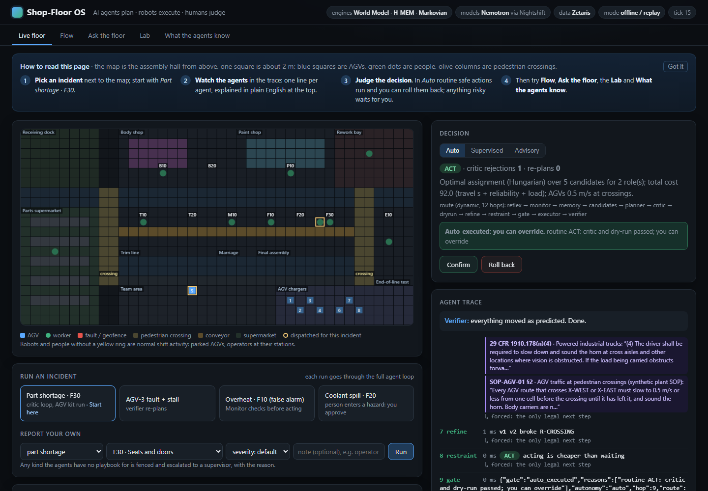
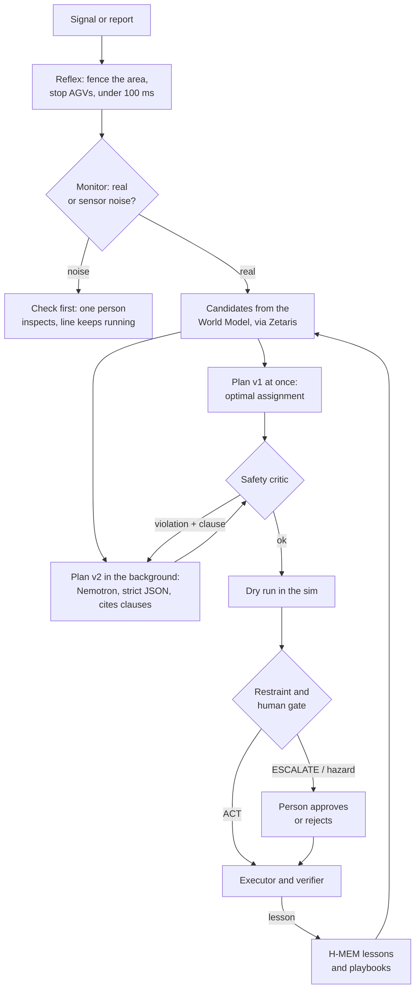

<div align="center">

# Shop-Floor OS

**AI agents plan, robots execute, humans judge.**
A multi-agent incident-response and AGV-dispatch system for a car final-assembly hall. The agents read the plant
through Zetaris, reason with NVIDIA Nemotron through Meterless Nightshift, and remember with Meterless engines.
Code checks every plan against OSHA clauses and simulates it before anything moves, and a person approves
whatever is risky.

[](#the-problem)
[](tests/)
[](docs/chaos.md)
[](docs/eval.md)
[](#meterless-nightshift-and-nvidia-nemotron)
[](#sponsor-technology)
[](#zetaris-the-data-layer)
[](LICENSE)

**[Replay site](https://hemanth-raja.github.io/shopfloor-os/)** · **[Evaluation](docs/eval.md)** ·
**[Chaos tests](docs/chaos.md)** · **[Production review](docs/production-readiness.md)** ·
**[Live demo runbook](docs/live-demo.md)**

</div>



## At a glance

| | |
|---|---|
| **The problem** | A missing kit, a stalled AGV, a spill or an overheating machine stops the line and can put people at risk. A supervisor has seconds to decide who to send, how the robots move, whether the alarm is real and whether acting is safe |
| **The rule that matters** | Nemotron proposes; code decides what is safe. Every plan passes a deterministic OSHA critic, a simulated dry run and a restraint gate, and a person approves anything that sends someone into a hazard |
| **Safety, measured** | 0 unsafe plans executed. The critic caught 216 of 216 planted unsafe plans and wrongly rejected 0 of 54 safe ones; live, Nemotron's first plan broke a rule in 6 of 27 calls and fixed all 6 after the critic's feedback ([docs/eval.md](docs/eval.md)) |
| **Fewer false dispatches** | The Monitor sent 19 false alarms to the floor where a plain threshold alarm sends 235 (600 noisy alarms, Brier 0.096 vs 0.392) |
| **Failure-tested** | 15 chaos scenarios (a model down, Nightshift down, 60% of calls failing, broken JSON, a different model answering, Zetaris down…) plus a 19-incident shift on flaky models: every one ends in a decision, nothing unsafe runs ([docs/chaos.md](docs/chaos.md)) |
| **Every model call, signed** | Three NVIDIA Nemotron models, each pinned to its own Nightshift app; every call records the requested and the answering model, and 6,021 of 6,021 Ed25519 receipts verify (`run.py receipts --verify`, 25 Oct 2026) |
| **Data** | Four sources federated by Zetaris and modelled as one Unified Semantic Layer; the agents read it on their own read-only login, so a write from an agent is refused by Zetaris itself |
| **Runs without us** | `SAMPLE_MODE=true` runs the real agent loop offline, with no keys, Zetaris or Nightshift |

## The problem
In vehicle final assembly, one car leaves the line about every minute. When something goes wrong at a station (a
kit does not arrive, an AGV stalls in an aisle, coolant spills, a nutrunner reports a bad torque, a weld robot
faults) the line stops, and every minute of stop costs cars. Some of these events also put people at risk: AGVs
cross pedestrian walkways, and repairing a robot cell needs lockout/tagout.

The data a supervisor needs is fragmented across systems: the AGV fleet manager, HR rosters and certifications,
plant and machine telemetry, and the operations history. Decisions are made under time pressure:
- who to send, and which robot to re-route;
- whether an alarm is real or sensor noise;
- whether acting is safe under OSHA rules and the plant's SOPs;
- whether to stop the line at all.

**Who it is for:** shift supervisors, team leaders and maintenance planners in vehicle assembly.
**Why it fits Track 3:** it turns data (Zetaris), knowledge (World Model, OSHA clauses), memory (H-MEM) and
reasoning (Nemotron) into decisions and actions that are checked, simulated, gated and verified.

## How it works
Four agent teams share one data layer, one model gateway and one set of deterministic safety checks.


<sub>Source: [docs/architecture.html](docs/architecture.html).</sub>

**One incident, start to finish.** There is no fixed pipeline: an orchestrator agent picks the next agent at
each step, but only among the moves that code allows (details in
[How an incident is handled](#how-an-incident-is-handled-a-dynamic-orchestrator)).



## What you can try in 2 minutes
No accounts, keys, Zetaris or Nightshift needed.

1. **One incident, JSON in and out.**
   ```bash
   python3 -m venv .venv && .venv/bin/pip install -r requirements.txt
   SAMPLE_MODE=true .venv/bin/python run.py run input_examples/example_1.json --out result.json
   ```
   stdout shows one `[INFO]` trace line per agent step, then the JSON result; `--out` also writes the JSON alone
   to `result.json`. A bad request returns `"status": "error"` with a message, and exit code 1.
   A part shortage at F30. The rules plan is ready at once; Nemotron's recorded plan sends AGV-5 through a
   pedestrian crossing at 1.0 m/s, the critic rejects it under 29 CFR 1910.178(n)(4), and the safe plan runs.
2. **The whole floor in a browser.** `SAMPLE_MODE=true .venv/bin/python -m app.server`, then open
   http://127.0.0.1:8000. Report an incident under the map, watch the agents in *Incidents*, ask
   "Why does F10 keep stopping?" in *Ask the floor*, and run an experiment in *Lab*.
   With Docker: `docker build -t shopfloor-os . && docker run --rm -p 8000:8000 shopfloor-os`.
3. **The judges' API check.**
   ```bash
   curl -X POST http://localhost:8000/run -H "Content-Type: application/json" -d @input_examples/example_3.json
   ```
   An overheat at F10 whose vibration evidence says sensor noise: the answer is VERIFY, and the line keeps running.
4. **Re-check a decision without any model.** Report an incident in the UI, then open
   `http://127.0.0.1:8000/api/verify/SIM-42-001` (live: `.venv/bin/python run.py verify SIM-42-003`). Code alone
   re-derives the decision from the saved trace: the plan passes the critic again, a plan had passed before
   dispatch, the human gate was respected, the plant data is the same snapshot, and the hash-chained journal holds
   the same outcome.

| Question | Where it is answered |
|---|---|
| What happens when it fails? | [Retrieval, context limits and failure handling](#retrieval-context-limits-and-failure-handling), [Resilience](#resilience-what-happens-when-things-go-wrong), [docs/chaos.md](docs/chaos.md) |
| What does it do without being asked? | [Autopilot](#autopilot-a-whole-shift-many-incidents-at-once) and [Autonomy levels](#autonomy-levels) |
| How can a person tell afterwards what it did? | per-run traces in `logs/`, the *Incidents* tab, `run.py verify`, `run.py audit`, `run.py handover` |
| Which model answered each call? | `logs/llm.jsonl` (requested and answering model), the *Nemotron at work* tab, `run.py receipts --verify` |
| Does the model add anything, and is it safe alone? | [docs/eval.md](docs/eval.md) sections 3 and 4: Nemotron alone vs the full loop |

## The plant (fictional)
A car final-assembly hall on a 20 x 40 grid (one cell is about 2 m):
- **10 stations:** body weld cell, hemming press, paint booth, two trim stations, powertrain marriage, three final-assembly stations and end-of-line test.
- **Areas:** a parts supermarket and kitting area, the receiving dock, a rework bay, AGV charging, and pedestrian walkways that cross the AGV lanes.
- **Fleet:** 8 AGVs: 5 kitting tuggers and 3 heavy body carriers. AGV-3 is old and unreliable.
- **People:** 24 fictional workers on shifts A (06-14), B (14-22) and N (22-06), with lockout/tagout, forklift and robot-cell certifications and with absences.
- **Production:** one car every 75 s, with 8 machines.
- **History:** 90 days, 20 Jul to 17 Oct 2026, with about 2,000 incidents. Each incident has time to clear, downtime, cars lost and an estimated cost.

| Zetaris datasource | Tables |
|---|---|
| sf_fleet | agvs, agv_tasks, agv_telemetry (every minute, last 7 days), fleet_hourly |
| sf_hr | workers, certifications, shifts |
| sf_plant | stations, machines, machine_telemetry (hourly, 90 days), vibration_samples, weather_hourly, production_plan, units, work_orders |
| sf_ops | zones, floor_cells, spill_kits, safety_rules, incidents, andon_events, data_sources, experiments |

## Setup
### 1. From a clean clone, without Zetaris, Nightshift or keys (sample mode)
```
git clone <this repo> && cd shopfloor-os
python3 -m venv .venv && .venv/bin/pip install -r requirements.txt
cp .env.example .env                       # an empty .env is fine for sample mode
SAMPLE_MODE=true .venv/bin/python run.py run input_examples/example_1.json
SAMPLE_MODE=true .venv/bin/python -m app.server       # web UI on http://127.0.0.1:8000
.venv/bin/python -m pytest -q                          # 309 offline tests
```
With Docker: `docker build -t shopfloor-os .` then `docker run --rm -p 8000:8000 shopfloor-os`. The image is
tested (174 MB) and defaults to `SAMPLE_MODE=true`.

`SAMPLE_MODE=true` still runs the real agent loop on the offline plant: simulator, A*, critic, dry-run,
restraint gate, executor and verifier. Recorded Nemotron replies (`logs/fixtures/`) are used where one exists
for that exact input. Otherwise a deterministic rule-based planner stands in, and it is still checked by the
critic. No output is read from `output_examples/`.

### 2. Live, with Zetaris and Meterless Nightshift
1. Install and start Zetaris (Docker) and Meterless Nightshift as described in the Participant Setup Guide and
   [zetaris.github.io/getting-started](https://zetaris.github.io/getting-started/).
2. Put the Zetaris REST URL, org id and API key, and the Nightshift base URL and runtime token, into `.env`
   (see `.env.example`). Choose a Postgres password for `PG_PASSWORD`. The NVIDIA key stays in Nightshift.
3. Load the data and register it in Zetaris (fully scripted, no manual steps):
```
bash scripts/start_postgres.sh          # Postgres container on the Zetaris Docker network
bash scripts/load_data.sh               # generate the plant from data/seed and load fleet, hr, plant, ops
.venv/bin/python -m app.zetaris register     # first time: create the sf_* Zetaris datasources
.venv/bin/python -m app.zetaris refresh      # after any reload
.venv/bin/python run.py health               # Zetaris and Nightshift through their circuit breakers
```
4. Optional, recommended: the agents' read-only login and the Unified Semantic Layer.
```
.venv/bin/python -m app.zetaris reader-role  # role SF_AGENT_READER: SELECT on the four sf_* datasources only
.venv/bin/python -m app.usl deploy           # USL 'floor' (9 tables with keys) over the sf_* sources
.venv/bin/python -m app.usl status           # its tables and activation flags
```
   Create a non-admin Zetaris user with the role `SF_AGENT_READER` and put its API key in `.env` as
   `ZETARIS_AGENT_API_KEY`; agent reads then use it and Zetaris refuses any write from them. Zetaris only exposes
   the USL access lists in its GUI, so give the role access there once: Management → Permissions (View on Unified
   Semantic Layer), and Data Product → Unified Semantic Layer → `shopfloor` → Access Control, then the `floor`
   model → Access Control. Until then the agents read the raw federated query instead, and say so in the logs.
   A redeploy of the USL empties those lists.

In Docker, use `host.docker.internal` instead of `localhost` for Zetaris and Nightshift.

Or do steps 3 onwards in one go: `bash scripts/start_live.sh` (idempotent; it starts the UI on a free port). The live demo runbook is `docs/live-demo.md`.

## Usage
| Entry point | Command |
|---|---|
| **JSON in, JSON out** (programmatic) | `.venv/bin/python run.py run input_examples/example_2.json` |
| **HTTP API** | `POST /run` or `POST /api/run` with the same JSON body (`python -m app.server`, port 8000); `GET /health` |
| **Web UI** | `python -m app.server`: *Live floor*, *Incidents*, *Ask the floor*, *Lab*, *Nemotron at work* and *What the agents know* tabs, Approve/Reject |
| One incident (CLI trace) | `run.py incident --kind agv_fault --agv AGV-3 --station F30 --stall-after 2` |
| Zone briefing | `run.py context --zone FINAL` (World Model built from one federated Zetaris query, plus a Nemotron summary) |
| **Ask the floor** (investigation) | `run.py ask "Why does F10 keep stopping?"` or the *Ask the floor* tab; `--json` prints the full result |
| Custom incident | the *Report your own* form under the map (kind, station, severity, note), or `input.severity` / `input.note` in the JSON contract |
| **Autopilot shift** | `run.py shift --minutes 8 --seed 7 --rate 2.5` or *Run shift* under the map: Sentinel, concurrent incidents, leases, summary |
| **Always on** | `python -m app.server --always-on` (or `ALWAYS_ON=true`): the Sentinel starts with the server and shifts follow each other until you press *Stop*; in the UI, *keep watching* next to *Run shift* |
| Lab experiment | `run.py lab [--write]` (hypothesis, then 20 seeded replays, then bootstrap CI, then an `sf_ops.experiments` proposal) |
| **Shift handover** | `run.py handover [--shifts 3]`: the shift journal read in bounded chunks on the Meterless Markovian engine, then a handover note |
| **Evaluation** | `run.py eval [--live]`: planted unsafe plans, random plans, Monitor calibration; `--live` adds a Nemotron-only baseline and 3x stability. Writes [docs/eval.md](docs/eval.md) |
| Static replay page | `python scripts/build_site.py`, then open `docs/site/index.html`; `.github/workflows/pages.yml` publishes it to GitHub Pages on push |

Request:
```json
{"run_id": "example-2",
 "input": {"kind": "agv_fault", "agv": "AGV-3", "station": "F30", "stall_after": 2, "seed": 42},
 "options": {"sample_mode": false, "memory": false}}
```
- `input.kind` is one of `part_shortage`, `agv_fault`, `overheat`, `spill`, `robot_cell_fault`, `torque_fault`,
  `near_miss` or `quality_defect`. All eight run through the full loop. A kind without a response playbook would be
  fenced and escalated to a supervisor with the reason, instead of being planned.
- Optional `severity` (`low`, `medium`, `high`, `critical`) and `note` (free text from the reporter).
- `station` is a station id (B10, B20, P10, T10, T20, M10, F10, F20, F30, E10).
- `false_alarm` makes an overheat sensor noise.
- `stall_after` stalls the dispatched AGV mid-route.

The response contains:
- `status`;
- `output`: decision, score, reasons, plan, citations, critic_rejections, replans, safe_mode, collisions;
- `agents`, with their roles;
- `models`, naming which model handled each request;
- `trace_id`, `log_file` and `execution_time_seconds`.

Failures return `status: "error"` with a typed `error` (`InvalidInput`, `UpstreamUnavailable`, and so on) rather
than a crash.

### Sample inputs and outputs
| Input | What happens | Output |
|---|---|---|
| `input_examples/example_1.json`: part shortage at F30 | The rules plan (v1, optimal assignment) is ready at once. Nemotron's plan (v2) sends AGV-5 at 1.0 m/s through the X-WEST crossing; the critic rejects it under 29 CFR 1910.178(n)(4), so v1 (0.5 m/s at crossings) stays. Result: ACT | `output_examples/example_1.json` |
| `example_2.json`: AGV-3 fault plus a stall | The replacement AGV-1 stalls mid-route. The verifier detects it and the loop re-plans with AGV-2. Result: ACT | `example_2.json` |
| `example_3.json`: overheat at F10, false alarm | The temperature is over its threshold, but the Bosch vibration recording is normal, so the sensors disagree. Result: VERIFY (a technician checks; the line keeps running) | `example_3.json` |
| `example_4.json`: coolant spill at F20 | A two-cell geofence goes up and AGVs stay out. The spill responder goes in, citing 29 CFR 1910.22. Result: ACT | `example_4.json` |
| `example_5.json`: robot-cell fault at B10 (weld robots) | The cell is fenced. Only a technician with in-date lockout/tagout and a robot-cell card may enter (29 CFR 1910.147, SOP-ROBOT-02). ACT, but it waits for a person to approve | `example_5.json` |
| `example_6.json`: nutrunner torque fault at F10 | v1 sends a tool technician and the torque auditor. Nemotron's v2 sends only the technician; the critic rejects it (SOP-TORQUE-01: joints since the last good torque must be re-audited), so v1 stays. A single NOK with `false_alarm` gives VERIFY | `example_6.json` |
| `example_7.json`: pedestrian near miss at F30 | The AGV involved is held where it stopped; a supervisor with incident command secures the scene. A safety event, so a person signs off | `example_7.json` |
| `example_8.json`: quality defect at end-of-line | A quality inspector contains the affected units (SOP-QUAL-01). Routine, auto-executed | `example_8.json` |

### Logs
**Watch it live:**
- **Incidents tab** in the web UI: every incident, running ones first, with its agent flow drawn as a graph (numbered hops, who chose each hop and why) and its full history: each agent's input and output, what was sent to Nemotron, the model that answered and the latency, approvals and timeouts.
- **`python run.py watch`** in a second terminal: one coloured, plain-English line per agent step, Nemotron call and human judgement, for example `12:03:04 PLANNER  1.2s  Nemotron-Super attempt 2 -> send W-18; AGV-5->F30 1.0/0.5 m/s`.

Every run writes `logs/trace-<run_id>.jsonl`, one JSON object per agent step. Each record has the agent, ok,
timing, inputs and outputs, critic violations with clauses, the model that answered, and retries and re-plans.
Every step is also printed as an `[INFO] run_id=… agent=…` line on stdout.

Other logs:
- `logs/llm.jsonl` records every Nightshift request with the requested and answering model and the latency.
- `logs/world_model.jsonl` records World Model builds.
- `logs/approvals.jsonl` records human judgements.

None of them contain secrets.

## Agents
| Agent | Role | Model |
|---|---|---|
| reflex | Geofences the incident and stops or re-routes AGVs, in under 100 ms | none (rules) |
| monitor | Real alarm or sensor noise, from thresholds plus Bosch vibration evidence; one-line summary | `monitor` role (summary only) |
| memory | Recalls H-MEM lessons from past incidents before planning | none (H-MEM ranking) |
| candidates | Top-3 qualified workers and healthy AGVs from the World Model (valid certifications; no service-overdue AGV for critical work) | none |
| planner | Chooses among the candidates; strict JSON; must cite the governing clauses | `planner` role |
| safety critic | Deterministic OSHA-based rule engine; cites the exact clause per violation; the planner gets up to 3 tries. Rules include lockout/tagout and robot-cell entry (robot-cell faults, overheats), torque re-audit (torque faults), the held AGV and supervisor sign-off (near misses) and inspector containment (quality defects) | none |
| dry-run | 60 s headless simulation with A* and a reservation table; fails on a collision or a late ETA | none |
| restraint | ACT, VERIFY, SAFE_HOLD, ESCALATE or DO_NOTHING, from confidence, sensor agreement and cost | none |
| executor / verifier | Dispatches in the sim and checks the world changed as predicted; re-plans on mismatch | none |
| health | Circuit breakers for Zetaris and Nightshift; safe mode when Nightshift is down | none |
| lab | Policy hypothesis, then 20 seeded replays (no LLM), then a bootstrap 95% CI | `lab` role (hypothesis only) |
| orchestrator | Chooses the next agent at each decision point, within the legal moves (see below) | `router` role |

## Ask the floor: investigating what happened
The incident loop reacts to one incident. *Ask the floor* looks back over everything that happened. A question such
as "Why does F10 keep stopping?" goes to a team of agents (`app/investigate/`):

| Agent | Role | Model |
|---|---|---|
| intake | Works out what the message is before anything goes to SQL. Code settles the clear cases, so they work with Nemotron down: a greeting gets a briefing of the live floor (by the real clock and shift); "someone is hurt" gets people-first instructions and never a model; a write ("delete all incidents") is refused; an action ("send AGV-3 to F30") is handed to the Live floor; a report ("coolant spill at F20") is checked against open incidents and pre-fills the report form; a follow-up ("and F20?") is rewritten against the last question. Only unclear messages go to the coordinator model, and its answer is validated | rules, then `coordinator` role |
| coordinator | Splits the question into 1–4 sub-tasks: SQL over the plant data, and the agents' own logs | `coordinator` role |
| SQL agent | Writes one read-only Spark SQL query per sub-task from the table catalogue, runs it on Zetaris; on a guard refusal or Zetaris error it gets the message and one retry. A task that builds on another runs after it and sees its rows | `sql_agent` role |
| SQL guard | One `SELECT`/`WITH` only, no `;`, no DDL/DML/`SET`/`REFRESH`, only whitelisted `sf_*` tables, `LIMIT` capped at 200 | none (rules) |
| log agent | Searches `logs/trace-*.jsonl` (decisions, critic rejections by rule, re-plans), `logs/llm.jsonl` (calls, latency, models) and H-MEM lessons | none |
| analyst | Correlates the evidence into findings, each citing evidence ids (E1, E2…) | `analyst` role |
| critic | First rules: drops any finding that cites missing or failed evidence, or quotes a number not found in the cited rows (totals of up to three values in one column are allowed). Then a different model re-checks the remaining claims against the rows; it can only drop | rules, then `evidence_critic` role |

Independent sub-tasks run in parallel. The answer shows its evidence: the SQL, row counts, the top rows and log
references, plus the claims the critic dropped and why. Each step streams to the UI and to `run.py watch`, and is
written to `logs/trace-ask-<id>.jsonl`. Without Nightshift, a rule-based coordinator and analyst use fixed queries.
In sample mode the three example questions replay recorded Nemotron replies and Zetaris rows; any other question
runs on an offline SQLite copy of the four sources, built from `data/seed` on first use.

**Asked earlier.** Every answer is kept with its time (`app/askhistory.py`, `GET /api/asks`). Asking the same
question again shows what changed since: the old summary, findings that are new or gone, and the evidence row
counts then and now, because new incidents arrive and the model may write a different query.

### The agents' own history, in Zetaris
The JSONL files in `logs/` are the source of truth (they work offline and survive a Zetaris outage). Every 30 s the
live server also copies new lines into Postgres (`app/logsync.py`, or `run.py logsync`), and Zetaris federates them
next to the plant data: `sf_ops.agent_steps` (one row per agent step), `sf_ops.llm_calls` (requested vs answering
model, latency, tokens) and `sf_ops.journal` (the hash-chained shift journal). Ask the floor sees these tables only
for questions about the agents, for example:

> *Which safety rule does the critic reject most often, and how often did the planner model answer as requested?*
> R-TORQUE-QA (233 rejections), then R-CROSSING (201); the planner was served the requested model in 77 of 78 calls.

## Lab in the loop: test a floor change, apply it, measure it
The incident loop learns from each incident (H-MEM lessons). The Lab asks a slower question: would changing the
floor itself make a whole class of incidents shorter? One *Run experiment* (`run.py lab`, the *Lab* tab):
1. **Reads history.** One Zetaris query summarises past spills and part shortages per station: count, mean time to
   clear, and the walking distance to the nearest spill kit or to the parts supermarket.
2. **Proposes a change.** Nemotron (the `lab` role) reads the summary, plus the runs already tested and what an
   applied change measured, and proposes one testable change: a spill kit at a station, or a loaded AGV waiting at
   one. With Nemotron down, a rule picks the busiest station, and the page says so in red.
3. **Re-scores history.** Every real incident of that kind is re-walked with A* on the floor grid, with and without
   the change; only the travel part of its clear time changes.
4. **Replays and measures.** 20 seeded replays and 2,000 bootstrap resamples give the change in mean time to
   clear with a 95% interval. No model runs inside the replays, so the same run gives the same answer.
5. **Apply and measure.** A significant result can be saved to Zetaris (`sf_ops.experiments`) and applied to the
   floor: the map shows it, and every later incident of that kind is measured with and without it
   (`app/lab/loop.py`), predicted saving next to measured. *Remove the change* takes it off; both survive a restart.

## Autopilot: a whole shift, many incidents at once
`run.py shift --minutes 8 --seed 7 --rate 2.5` runs headless; the **Run shift** form under the map runs it in the UI.

```
floor signals --> Sentinel (rules; dedupe; correlate; Lightning triage of ambiguous signals only)
             --> priority queue (people at risk, then severity, then expected cost)
             --> dispatcher: N incidents at once, each on its own dynamic route
             --> leases on people and AGVs (pre-emption by risk; expiry) --> human gate per autonomy level
```
- **Sentinel** (`app/autonomy/sentinel.py`) watches a stream of floor signals. The stream is generated from the
  historical incident mix in `sf_ops.incidents`, deterministic for a seed. The signals are line-side stock, AGV
  status, machine temperature with Bosch vibration, spill cameras, robot controllers, nutrunner torque, proximity
  and quality checks, plus continuous telemetry (machine temperature every 30 s, stock every 20 s).
  - Adaptive detection (`app/autonomy/detectors.py`): each machine's temperature baseline per shift comes from
    `sf_plant.machine_telemetry` and then follows the stream by EWMA (learning only from normal readings);
    |z| >= 3 is an anomaly and 2-3 goes to triage; a CUSUM raises an early warning on a slow drift before any
    single reading looks abnormal. Line-side stock is projected from its consumption trend, so a shortage is
    raised before the 5-minute floor. Hard limits are fixed per machine (historical mean + 4 sd, at least 313 K)
    and person-safety limits never adapt.
  - Rules raise the clear cases.
  - A repeat alarm is merged while its incident is open, and an AGV fault absorbs the shortage it causes at the
    station it was feeding.
  - Only ambiguous readings are triaged by the `sentinel` role (Lightning). A person-safety signal can never be
    dismissed.
  - A station failing repeatedly in one shift gets a higher severity; a persisting condition is not raised again
    right after its incident is handled unless it gets worse (a hard-limit breach always gets through).
  - Every decision is logged in `logs/sentinel.jsonl`.
- **Dispatcher** (`app/autonomy/dispatcher.py`) keeps a priority queue and runs several incidents at once, each
  with its own orchestrator.
  - An incident that puts people at risk jumps in even when every slot is busy.
  - The orchestrator is a step generator, so incidents interleave hop by hop. This is deterministic in sample
    mode; live, each incident gets a thread, so model calls overlap.
  - Hops that move things on the floor take the floor lock.
- **Leases** (`app/autonomy/leases.py`) stop two incidents from sending the same person or robot.
  - Candidates skip resources held by an equally or more urgent incident, and the critic rejects a plan that uses
    one (`R-LEASE`).
  - A more urgent incident pre-empts a less urgent one, which re-plans. The trace shows this as an `arbiter` step.
  - Leases expire (5 minutes of floor time), so nothing deadlocks.
  - Responders walk back once their job is done, and each incident has its own geofence.
- **Human gate:** the autonomy setting still applies. The Shift panel lists what is waiting for you, with
  Approve and Reject per incident, and clicking an incident opens its route in the *Incidents* tab.
- **Summary:** incidents, decisions, how many were resolved without a person, how many waited, escalations, mean
  time to resolve, pre-emptions, peak concurrency, quality holds (MES), and cars saved with a bootstrap 95%
  interval over real historical incidents of each kind.
- **Durable:** the queue, leases (with fencing tokens), dispatches, approvals and results go to a hash-chained
  journal (`logs/journal.jsonl`, replicated to Postgres `ops.journal`); after a crash, interrupted incidents are
  handed to a person (`run.py audit` verifies the chain).
- **Runtime safety:** an invariant monitor checks the floor after every tick, independently of the critic.

**Caching** (`app/cache.py`, hit rates in `/health`):
- read-only Zetaris results, 120 s, cleared by any write;
- incident history per kind, station and 10 minutes;
- H-MEM clause retrieval;
- counted replay hits in sample mode.

## How an incident is handled: a dynamic orchestrator
There is no fixed pipeline. After the reflex, an **orchestrator agent** (`app/dynamic.py`) chooses which agent runs
next, hop by hop. At each decision point the router model (role `router` in `config/models.json`) gets a compact
state and the agents that are legal right now, and returns strict JSON `{next_agent, reason, args}`.

| Agent | What it does | Model |
|---|---|---|
| reflex | Geofence, stop or re-route AGVs, in under 100 ms. Always first | none (rules) |
| monitor | Real alarm or sensor noise, from thresholds and Bosch vibration evidence; one-line summary | `monitor` role |
| memory | H-MEM lessons and the playbook for this kind and station | none (H-MEM ranking) |
| investigator | History through Zetaris (guarded SQL) for this kind, station and AGV: false-alarm share, downtime | none |
| candidates | Top qualified people and healthy AGVs from the World Model (one federated Zetaris query) | none |
| playbook | Re-uses a proven H-MEM playbook on today's candidates: no model call | none |
| check first (`verify_plan`) | One qualified person inspects before anything else moves: no model call | none |
| planner (anytime) | v1 at once by optimal assignment (Hungarian algorithm over roles × candidates: travel, reliability, load; infeasible if a skill or certificate is missing); Nemotron's strict-JSON v2 in the background | none for v1, `planner` role for v2 |
| refine | Checks v2 with the critic and the dry run; swaps it in only if it is safe and scores better | none (rules) |
| safety critic | OSHA rules and SOPs with exact clause citations; violations go back as feedback | none (rules) |
| dry run | 60 s headless simulation, A* with a reservation table | none |
| restraint | ACT, VERIFY, SAFE_HOLD, ESCALATE or DO_NOTHING from confidence, sensors and cost | none |
| human gate, executor, verifier | Autonomy-level approval; dispatch; check the world changed as predicted | none |

**Guardrails are code, not prompts.** The model can only choose among the legal agents, and:
- the reflex always runs first;
- the executor runs only after the latest plan passed the critic and the dry run, and the human gate allowed it;
- the human gate always runs before anything moves;
- an illegal or unknown choice is rejected, logged as a `router` step, and the rule-based router decides;
- once Nightshift is unavailable, the planner is replaced by safe mode (rule-based plan, ESCALATE);
- a hop budget (24) ends a runaway loop with ESCALATE; at most 6 router model calls per incident, and a forced move
  (one legal agent) costs no call.

**Different incidents take different routes** (`output_examples/` shows each one):
- false alarm: monitor → investigator → check first → critic → VERIFY, with no planner call;
- a case the floor has handled well before: memory → playbook → critic, with no planner call;
- ambiguous: investigator before planning;
- critic rejection: back to the planner with the violations, or to candidates;
- verifier mismatch: back to candidates without the failed AGV, then the planner.

The rule-based router follows the same policy without a model. It is used in sample mode, when Nightshift is
down, and after the router-call budget. The *Incidents* tab draws the route as a graph with numbered hops, the
reason for each hop and who chose it, and can show the previous incident's route next to it. The original fixed
pipeline is kept for comparison: `run.py incident --linear`, `options.mode: "linear"` or `POST /run {"mode": "linear"}`.

**Autonomy and the human gate.** The UI switch, or `options.autonomy` in the API, sets how much the agents may do alone:
- **Auto (default):** a routine ACT that passed the critic and the dry-run runs at once, and a person can *Roll back*, which stops the agents and sends them back. A person entering a hazard (spill clean-up, machine repair), a lapsed certificate, or an ESCALATE, SAFE_HOLD or DO_NOTHING decision waits for *Approve*.
- **Supervised:** every dispatch waits for approval.
- **Advisory:** the agents only recommend, and a person dispatches.

On the map, the agents dispatched for the current incident have a yellow ring; everything else is normal shift activity. Every judgement is logged to `logs/approvals.jsonl`.

Every loop is bounded:
- critic retries: 3;
- re-plans: 3;
- Zetaris requests: 60 s;
- planner calls: 90 s.

Every external dependency sits behind an adapter: `app/zetaris.py` and `app/llm.py`, wrapped by the circuit
breakers in `app/runtime.py`.

## Dependencies
- **Python 3.11+** and `requirements.txt`: openai (the OpenAI-compatible client for Nightshift), python-dotenv,
  requests, pydantic and pytest. The generator, simulator, engines and web server use only the standard library.
- **Live mode:** Zetaris (local Docker), Postgres 16 (Docker container `shopfloor-pg`, created by
  `scripts/start_postgres.sh`) and Meterless Nightshift, with NVIDIA's hosted Nemotron models. No GPU is needed.
- **Optional rebuild of `data/seed/`:** `requirements-data.txt` (h5py), used only by `app/data/fetch_sources.py`.

## Sponsor technology

### Zetaris: the data layer
Every read the agents make goes through Zetaris (`app/zetaris.py`, the only data access layer), and every Zetaris
object was created in code through its SQL REST API, so a fresh install is rebuilt by commands, not by clicks.
- **Four sources, one query.** Four Postgres databases are registered as the datasources `sf_fleet`, `sf_hr`,
  `sf_plant` and `sf_ops` (`python -m app.zetaris register`). Every incident starts with **one federated Lightning
  SQL query** across all four (`app/engines/plant_world.py`): stations, machines, workers with their
  certifications, AGVs with live position, safety rules and cost history.
- **Unified Semantic Layer.** `app/usl.py` defines the USL `floor` (9 business entities with primary and foreign
  keys: zone, station, machine, worker, certification, agv, vibration_sample, safety_rule, incident) over the raw
  sources, and deploys and activates it. `run.py context` reads through it, and falls back to the raw federated
  query if the USL is unavailable (the World Model log records which one was used).
- **Read-only agents.** The agents read on their own Zetaris login whose only role, `SF_AGENT_READER`, has SELECT on
  the four datasources and the USL. A write from an agent is refused by Zetaris itself, on top of our SQL guard
  (one read-only statement, whitelisted `sf_*` tables, capped `LIMIT`). The operator login is kept for register,
  refresh and the Lab's write.
- **Investigations.** *Ask the floor*'s SQL agent writes Spark SQL from the table catalogue and runs it on Zetaris;
  the investigator and the Lab read incident history the same way.
- **Writes back.** Lab proposals go back through Zetaris (`INSERT INTO sf_ops.experiments`), and the agents' own
  logs are synced every 30 s into `sf_ops.agent_steps`, `sf_ops.llm_calls` and `sf_ops.journal`, so the agents can
  be questioned about their own behaviour with the same SQL as the plant.

### Meterless engines
Three engines are implemented in Python from the Meterless specs and each runs a feature, with its conformance tests:
- **World Model** (`app/engines/world_model.py`) grounds every plan: stable ids, provenance, facts such as
  `service_overdue`, and `ground()`, which rejects ids that do not exist. `tests/test_world_model.py` ports the
  spec's 8 conformance checks.
- **H-MEM** (`app/engines/hmem.py`) holds the incident playbooks, the critic's lessons with outcome feedback, and
  the OSHA/SOP clause index that the planner and critic cite. `tests/test_hmem.py` runs all 13 official vectors.
- **Markovian** (`app/engines/markovian.py`) writes the shift handover (`run.py handover`) by reading a whole
  shift's journal in bounded chunks with compressed carryover: 67% fewer prompt tokens on a live three-shift run.
  `tests/test_markovian.py` covers it.

### Meterless Nightshift and NVIDIA Nemotron
Nightshift is the only model provider: every call goes through `app/llm.py` and `app/models.py` to
`MODEL_BASE_URL`, and the NVIDIA key stays inside Nightshift. Every model is an NVIDIA Nemotron model.
- **One app per model.** Nightshift routes by app name, so each model is called under its own app, pinned in
  Nightshift's app policy to exactly one lane: `shopfloor-os-ultra` → Nemotron 3 Ultra 550B, `shopfloor-os` →
  Nemotron 3.5 Super VL 120B, `shopfloor-os-fast` → Nemotron 3.5 Lightning 30B. A startup self-check asks each one
  who answers, and a role's chain skips any model that is not really served.
- **Proof per call.** Each call records the requested and the answering model and the id of Nightshift's signed
  receipt, and the receipt's Ed25519 signature is verified at the moment the answer is used. `run.py receipts
  --verify` re-checks all of them (6,021 of 6,021 on 25 Oct 2026).
- **NVIDIA's guidance applied.** Reasoning and the answer share the token budget, so reasoning is switched off
  for the small, frequent decisions (router, monitor, Sentinel triage) and set to medium for the coordinator and
  the SQL agent; the planner, analyst, Lab and handover keep the model's default reasoning with a larger budget.
- **Nemotron at work.** A tab and `GET /api/nemotron?hours=` count, from the logs and traces rather than from
  claims, what Nemotron decided: calls and tokens per role, which model answered, orchestrator hops chosen by
  Nemotron vs forced by code, plans it wrote, refinements kept or rejected and why, and receipts verified.

### Cursor
The project rules live in `.cursor/rules/shopfloor.mdc` and `AGENTS.md` (kept in sync). Cursor built the model
client (`app/llm.py`) and its tests; Claude Code was also used (see *Disclosure*).

### What is unique
- **Three Meterless engines work together.** The World Model grounds ids and facts, H-MEM ranks both lessons and
  regulatory clauses, and Markovian reads a whole shift's journal in bounded chunks for the handover.
- **The model never acts unchecked.** Nemotron proposes and routes; deterministic code with clause citations
  decides what is safe, simulates it, gates it and verifies the result, and a decision can be re-derived later
  with no model at all (`/api/verify/<id>`).
- **Zetaris is also the agents' memory of themselves.** Their own steps, model calls and journal are federated
  next to the plant data, so "how often did the critic reject the planner, and why?" is one SQL query.

## Models: which model serves which agent
`config/models.json` maps each agent role to a chain of models, chosen by capability. `app/models.py` tries the
chain in order through Nightshift.

| Role | Model chain (first choice first) | Reasoning | Why |
|---|---|---|---|
| router (orchestrator), monitor, sentinel | Nemotron 3.5 Lightning 30B A3B → 3.5 Super VL | off, hedged | small, frequent decisions over a short state: lowest latency (3B active parameters) |
| planner, analyst, lab | Nemotron 3 Ultra 550B → 3.5 Super VL 120B → Lightning | model default (on) | the hardest reasoning: grounded multi-constraint plans with clause citations, findings over evidence, policy ideas |
| coordinator, sql_agent | Nemotron 3.5 Super VL 120B → Lightning | medium | splitting a question and writing Spark SQL over the catalogue |
| handover, handover_reflect | Nemotron 3.5 Super VL 120B → Lightning | model default (on) | the Markovian chunks and the final note |
| evidence_critic | Nemotron 3.5 Lightning → Super VL | default | a different model from the analyst, for an independent check; it can only drop claims |

The safety critic, dry run, restraint gate and executor are deterministic code and use no model.
Llama-3.3-Nemotron-Super 49B is in Nightshift too, but as a judge lane: it grades answers and refuses to answer a
request itself, so no role can use it directly.

- Each model has its own circuit breaker. After two failures it opens, and the next model in the chain answers at once.
- Every role has a latency budget (the call timeout) and a token budget.
- Every call records the **requested** and the **answering** model. Nightshift can serve a different model from
  the one requested.
- Every call also records the id of **Nightshift's signed receipt** for that request, matched on the response id.
- All of this appears in the trace (`model_call`), in `logs/llm.jsonl`, in the *Incidents* tab's agent details,
  and in the *Models* panel on *Nemotron at work*, which shows live latency and breaker states.

`scripts/probe_models.py` asks every NVIDIA model Nightshift lists for a one-word reply. It records who really
answered in `data/model_probe.json`. **Nightshift, not the model id, decides the route.** For a named app, Nightshift
records the requested model but routes by that app's rule, which is why each model has its own app name
(`model_apps` in the config) with a one-lane allowlist in Nightshift's app policy. When NVIDIA's endpoint returns an
error or an empty reply, the chain moves on and the trace says so.

## Meterless engine: World Model
Shop-Floor OS implements the **Meterless World Model** engine in Python, in `app/engines/world_model.py`. It is a
port of the spec in github.com/Meterless/Meterless `engines/world-model` (Apache-2.0), and a reference copy of the
spec and conformance runner can be fetched into `data/raw/meterless/`.
- **The engine:** an event-sourced store of entities, contexts and bitemporal relationships, with stable
  content-derived ids, provenance on every write, banded name resolution (auto-merge at 0.85 or above, review queue
  from 0.82), idempotent ingest, an ordered audit log, and graph, facts, snapshot and timeline views.
- **The feature:** `run.py context --zone FINAL` sends one federated Zetaris query, and
  `app/engines/shopfloor_world.py` builds the zone's world from it:
  - incidents, stations, machines, workers, AGVs and Bosch vibration recordings, with their links;
  - grounded checks, such as whether the responder's lockout/tagout was valid and whether the AGV's service is
    overdue.

  The Nemotron prompt receives the world model's structured context payload, not raw rows. `ground()` lets a
  planner reject entity ids that are not in the world.
- **Tests:** `tests/test_world_model.py` ports the spec's conformance checks (sid-001, sid-002, band-001,
  prov-001, idem-001, idem-002, bitemp-001 and audit-001) plus the reference smoke tests.
  `tests/test_shopfloor_world.py` covers the shop-floor builder. Run them with `.venv/bin/python -m pytest`.

## Meterless engine: H-MEM
The incident playbooks (`app/engines/playbooks.py`) run on a Python port of the **Meterless H-MEM** engine,
in `app/engines/hmem.py`. It follows the spec in github.com/Meterless/Meterless `engines/hmem` (Apache-2.0).
- Each critic lesson is stored as an H-MEM record with its source incident, tags and a confidence score.
- Before planning, the orchestrator recalls lessons with H-MEM's 8-signal hybrid ranking. Every outcome then
  feeds back into the record: helpful when the lesson held, not_helpful when the rule was broken again anyway.
  All of it goes through the append-only trust ledger.
- Sleep, conflict resolution and dreaming are implemented with the spec's guardrails.
- `tests/test_hmem.py` runs all 13 official conformance vectors, copied unchanged into `tests/fixtures/`.

## Meterless engine: Markovian (shift handover)
The shift handover (`app/handover.py`) runs on a Python port of the **Meterless Markovian** engine, in
`app/engines/markovian.py`, following the Meterless "Markovian Agent Engine" reference (headless, v1.0).
- A shift writes hundreds of journal lines. They are cut into slices of 40 compact lines; each chunk sends Nemotron
  3.5 Lightning only a 200-character goal summary, the carried state and one slice, never the earlier slices.
- The model ends each chunk with `[STATE_CHECKPOINT]` and a state summary (counts, open incident ids, risks);
  `[TASK_COMPLETE]` ends the chain. The carryover goes through the spec's cascade in strict order: explicit state,
  model compression, key-phrase extraction, tail truncation, so a model outage still leaves usable state.
- Nemotron 3.5 Super VL writes the final note from the carried state (the spec's reflection step); a failed
  reflection keeps the partial output.
- Every run is a record in `logs/markovian.jsonl`: per-chunk prompt size, carryover size and which compression tier
  was used. The command prints the real prompt tokens against what re-sending the history would have cost
  (characters / 4, the spec's estimate, not a tokenizer).
- Measured on a live run over three shifts (255 journal events, 5 chunks, Nemotron 3.5 Super VL): 8,326 prompt
  tokens sent, against 25,042 if each step had re-sent the earlier slices and answers (67% saved, chars/4 estimate).
  The carried state never went above about 260 tokens.
- `tests/test_markovian.py` checks config bounds, the marker protocol, the cascade order, the spec's token
  formulas, abort and reflection failure, and the handover slicing (no network).

## What is real and what is synthetic
**Synthetic.** These are generated by `app/data/generate.py` with seed 42, so every run gives the same data:
- the layout, stations, machines, AGVs and their tasks and telemetry;
- the people, certifications and rosters;
- the plant SOPs in `data/seed/plant_sops.json`, written for this fictional plant;
- production, units, incidents, andon pulls and work orders;
- the cost figures. These are our own assumptions for ranking incidents, not industry figures: $1,500 per minute of line stop, $85 per labour hour and $400 per rework.

No open dataset of car-plant operations (AGVs, andon, downtime) was found under an open licence, so these parts are simulated. Each one is shaped by the real data below.

**Real data used.** The summaries are stored in `data/seed/` and committed. If a file is missing, the generator uses a documented fallback, and the table `sf_ops.data_sources` records which source was used.

| Source | Used for | Licence and credit |
|---|---|---|
| UCI AI4I 2020 Predictive Maintenance | Hourly machine telemetry (air and process temperature, rpm, torque, tool wear, failure flags). Rows are reused across machines, and temperatures are shifted with the outdoor weather. | CC BY 4.0. Matzka, S. (2020), UCI Machine Learning Repository, DOI 10.24432/C5HS5C. AI4I itself is a synthetic dataset modelled on real machines. |
| OSHA Severe Injury Reports, NAICS 3361 (Jan 2015 to Nov 2025, 321 reports) | The mix of safety-event types (vehicle/pedestrian, caught in machinery, slips, heat and so on). Only aggregated counts by event type are stored; employer names, addresses, locations and narratives are dropped on download. | Public domain, U.S. Department of Labor. No endorsement implied. |
| BLS Survey of Occupational Injuries and Illnesses, NAICS 3361 | 5.6 recordable cases per 100 full-time workers (2024). That rate × 24 workers × 90 days gives the expected recordable injuries, and Heinrich's 1:29:300 ratio (a heuristic) scales it to about 110 safety events. | Public domain, U.S. Bureau of Labor Statistics. |
| Open-Meteo historical weather, Detroit MI | Hourly outdoor temperature. It heats the machines and drives overheat alarms. | CC BY 4.0. Weather data by Open-Meteo.com |
| Bosch CNC Machining dataset (UCI 752), 3-axis vibration at 2 kHz from three CNC machines | `vibration_samples`: all 70 recordings labelled abnormal plus a stratified sample of 280 normal ones, summarised per axis (RMS, peak, crest factor, kurtosis). The raw HDF5 files are not kept. Each torque alarm on the wheel nutrunner M-06 cites a recording: an abnormal one for real faults, a normal one for false alarms, so agents can check fault against noise. These are milling-machine signals used as a stand-in for nutrunner vibration. | CC BY 4.0. Tnani, M.-A., Feil, M., Diepold, K. (2022), "Smart Data Collection System for Brownfield CNC Milling Machines: A New Benchmark Dataset for Data-Driven Machine Monitoring", Procedia CIRP 107. github.com/boschresearch/CNC_Machining |
| MovingAI MAPF benchmarks: 4 warehouse maps | `data/seed/mapf/*.map`, kept for path-planner benchmarks. The 200 matching scenario files are an optional download into `data/raw/mapf/`. | Open Data Commons Attribution License. Stern, R. et al. (2019), "Multi-Agent Pathfinding: Definitions, Variants, and Benchmarks", SoCS. movingai.com/benchmarks/mapf |
| Meterless H-MEM engine spec and conformance vectors | `app/engines/hmem.py` and `tests/fixtures/hmem_vectors.json` (unchanged copy) | Apache-2.0. github.com/Meterless/Meterless, engines/hmem |
| Meterless World Model engine spec | `app/engines/world_model.py`, a Python implementation of the spec, with the conformance checks ported to pytest | Apache-2.0. github.com/Meterless/Meterless, engines/world-model |
| OSHA 29 CFR 1910.22, 1910.147, 1910.178, 1910.212, 1910.217 | Paraphrased rule summaries in `safety_rules`, plus 14 verbatim clause excerpts (`data/seed/osha_1910_excerpts.json`, eCFR) that the critic and planner cite. These are indexed in H-MEM together with 7 synthetic plant SOPs (`data/seed/plant_sops.json`). | Public domain, U.S. Department of Labor, via eCFR (ecfr.gov). No endorsement implied. |

## Patterns in the data (planted, for the agents to find)
- F10 Wheels and tyres is the hot spot for part shortages, torque faults and defects.
- AGV faults concentrate on AGV-3, which is old, low on battery health and overdue for service.
- Shortages rise when the kitting fleet is busy, either from high demand or an AGV being down.
- Time to clear grows with distance from the supermarket (shortages) and from the nearest spill kit (spills).
- Machine overheats are about three times as likely in hot hours, and about a quarter are false alarms from noisy sensors.
- Some wheel-nutrunner alarms are sensor noise (20 of 150 in this build); the linked Bosch vibration recording shows which.
- The night shift is thinly staffed and clears incidents more slowly.
- Some repairs were done by people whose lockout/tagout or forklift certification had lapsed.
- Body carriers cross the west pedestrian crossing faster than the 0.5 m/s rule allows.

All people, car models and the plant itself are fictional.

## Disclosure
1. **Models (via Meterless Nightshift):**
   - `nvidia/nemotron-3-ultra-550b-a55b` first for the planner, analyst and Lab;
   - `nvidia/nemotron-3.5-super-vl-120b-a12b` (`NEMOTRON_DEEP`) for the coordinator, SQL agent, handover and zone
     briefing, and as the second choice for the planner, analyst and Lab;
   - `nvidia/nemotron-3.5-lightning-30b-a3b` for the router, monitor, Sentinel triage and evidence critic, and as
     the last fallback everywhere.
   The full map is under *Models*; `logs/llm.jsonl` and the receipts show which model answered each call.
2. **Agent frameworks:** none. The orchestration is our own code (`app/dynamic.py`, `app/orchestrator.py`), using Pydantic contracts
   for strict JSON between agents.
3. **Integrations:** Zetaris, Meterless (World Model, H-MEM, Markovian, Nightshift) and NVIDIA, as described under Sponsor technology.
4. **AI coding tools:** Claude Code (Anthropic) wrote most of the code and documentation; Cursor wrote the model
   layer (`app/llm.py`, `tests/test_llm.py`). The team reviewed and tested all of it.
5. **External libraries:** openai, python-dotenv, requests, pydantic and pytest; h5py and numpy only for the
   optional data rebuild.
6. **Data:** the plant, people, incidents and SOPs are synthetic, anchored on public data (see "What is real and
   what is synthetic").
7. **Adapted open source:**
   - `app/engines/world_model.py` and `app/engines/hmem.py` are Python ports of the Meterless engine specs and
     reference code (github.com/Meterless/Meterless, Apache-2.0).
   - The H-MEM conformance vectors are copied unchanged.
   - The MovingAI maps are included under ODC-By.
8. **Known limitations:** see below.
9. **Fallback behaviour:**
   - `SAMPLE_MODE=true`: recorded replies plus a rule-based planner, the offline plant and no network.
   - Circuit-breaker safe mode when Nightshift fails: a rule-based plan and ESCALATE.

## Retrieval, context limits and failure handling
**Retrieval (RAG), without a vector database.** The models never get raw tables or whole documents; each agent
retrieves what it needs:
- *Regulations:* OSHA 29 CFR 1910 excerpts (eCFR) and plant SOPs are H-MEM records (`app/engines/citations.py`).
  The planner is shown the clauses H-MEM ranks for the incident kind, the critic attaches the exact clause to every
  violation, and cited references are resolved back to their text (unknown references are flagged).
- *Experience:* H-MEM lessons and playbooks are recalled per incident kind and station before planning.
- *Facts:* the World Model, built from one federated Zetaris query, gives grounded entities; `ground()` rejects
  ids that do not exist.
- *History:* the investigator and Ask the floor retrieve through guarded SQL on Zetaris and a search of our own
  traces.

**Context limits.** The largest prompt in our logs is about 7.5k tokens. Nemotron 3.5 Lightning has a 262k-token
window and Super VL 1M. Limits are enforced in code anyway:
- before each call, `app/models.py` estimates the prompt and skips any model where prompt plus `max_tokens` would
  exceed half its window (`context_tokens` and `context_fraction` in `config/models.json`);
- each role has a token budget (`max_tokens`) and a time budget (`budget_s`);
- prompts carry compact state: World Model payloads, at most 15 rows per SQL result, SQL capped at 200 rows, and
  the last 200 model-log lines;
- the orchestrator has a hop budget (24) and at most 6 router calls per incident.

**When a model fails.**
1. A timeout, HTTP 5xx or 429, an empty reply or a reply that fails schema validation (after one retry) moves to
   the next model in the role's chain.
2. Each model's circuit breaker opens after two failures, and later calls skip it at once until a cooldown.
3. If every model fails, the Nightshift-wide breaker opens. The router falls back to rules, the planner is replaced
   by safe mode (a rule-based plan plus ESCALATE, so a person decides), and the investigator uses rule-based
   stand-ins.
4. Each fallback is visible: the trace records the requested and answering model, the models tried and why, and
   `router` and `safe_mode` steps.
5. `SAMPLE_MODE=true` runs the whole system offline from recorded replies.

Tests cover each path: `tests/test_models.py`, `tests/test_dynamic.py`, `tests/test_agent_loop.py` and
`tests/test_health.py`.

**When retrieval goes wrong.** Retrieval is treated as untrusted input; nothing retrieved is acted on unchecked.

| Retrieval failure | What happens | Where |
|---|---|---|
| The SQL agent writes unsafe or invalid SQL | The guard allows one read-only `SELECT` on whitelisted `sf_*` tables; the rejection reason or Zetaris error goes back for one retry | `app/investigate/sqlguard.py`, `app/investigate/investigator.py` |
| A query fails or returns nothing useful | The evidence is marked failed; any claim citing it is dropped with the reason | `investigator.py` (evidence critic) |
| The analyst states a number the data does not contain | Every number in a claim must appear in the cited evidence, or the claim is dropped; a Lightning critic then reviews what is left | same |
| Clause retrieval ranks the wrong regulation | The safety critic is code over `sf_ops.safety_rules`, not over what was retrieved, so a bad ranking cannot approve a plan; a rule the code cannot check blocks automatic action (default-deny) | `app/agents/safety_critic.py` |
| The planner cites a clause that does not exist | Unknown references are flagged in the trace and dropped from the plan's citations | `app/engines/citations.py` |
| The model names a person or robot that does not exist | World Model `ground()` rejects the id (GROUNDING violation) and the planner gets the reason | `app/agents/planner.py` |
| A cached read is stale | Read-only Zetaris results expire (TTL), and any write clears the cache, so agents never read their own stale state | `app/cache.py` |
| Retrieved lessons are wrong | H-MEM lowers a lesson's confidence when its outcome is not_helpful, and every plan still goes through the critic | `app/engines/playbooks.py` |

## Resilience: what happens when things go wrong
| Failure | What the system does | Where |
|---|---|---|
| NVIDIA endpoint returns 5xx, 429, an empty reply or times out | Retries on the same model with full-jitter exponential backoff, inside the incident's deadline; then the next model in the role's chain | `app/models.py`, `app/resilience.py` |
| A model gets slow or overloaded | A per-model AIMD concurrency limit halves on errors or very slow replies and grows back slowly; the router, monitor and Sentinel hedge to the next model after 1.5x their median latency | same |
| A model keeps failing | Its circuit breaker opens; half-open lets exactly one probe through | `app/agents/health.py` |
| Nightshift serves a different model than pinned | Startup self-check and live drift rates; the effective chain skips it; Health warns | `app/models.py` |
| The model's JSON is broken | Mechanical repair first, then one re-ask, then the next model | `app/resilience.py` |
| The model is slow or down during an incident | Anytime planning: the optimal-assignment plan (v1) is ready in milliseconds; the model's v2 replaces it only if it passes the critic and the dry run and scores better; with Nightshift down, v1 is used and a person approves | `app/agents/assign.py`, `app/dynamic.py` |
| A plan breaks a safety rule | The critic rejects it with the clause; a rule it cannot check blocks automatic action (default-deny) | `app/agents/safety_critic.py` |
| Something unsafe happens anyway on the floor | The runtime invariant monitor stops the AGV (AGV in a fence with a person, fast at a crossing) or escalates (no lockout/tagout in a robot-cell area); the fleet layer caps AGVs at 0.5 m/s on crossings whatever the plan says | `app/sim/invariants.py`, `app/sim/sim.py` |
| Two incidents want the same person or robot | Leases with fencing tokens; higher risk pre-empts, the loser re-plans; a stale holder's command is refused; repeated dispatches are idempotent | `app/autonomy/leases.py`, `app/connectors.py` |
| The process crashes mid-shift | The hash-chained journal is replayed: interrupted incidents go to a person, their leases are void, tokens resume above the last one | `app/journal.py` |
| Someone edits the logs | Journal and approvals are hash chains (HMAC with `JOURNAL_HMAC_KEY`); `run.py audit` finds the first bad line | `app/journal.py` |
| Zetaris is slow or down | Breaker, 60 s timeout, read cache cleared by any write; sample mode runs offline | `app/runtime.py`, `app/cache.py` |
| Sensors drift slowly | EWMA baselines from history plus CUSUM raise an early warning before any fixed threshold; hard limits never adapt | `app/autonomy/detectors.py` |

Every one of these has tests, including seeded property-based fuzzing of the critic and the runtime monitor
(`tests/test_fuzz_safety.py`, `FUZZ_SEEDS=25` for a longer run). `python run.py eval` measures them: planted unsafe
plans, random plans judged only by the runtime monitor, Monitor calibration and, with `--live`, a Nemotron-only
baseline and 3x stability. Results: [docs/eval.md](docs/eval.md).

## What broke and how we fixed it
Things that failed during the build, found by tests, fuzzing, the runtime monitor or the eval, and what we changed.

| What broke | How we found it | Fix |
|---|---|---|
| The rule-based fallback plan sent a worker without valid lockout/tagout to a robot-cell fault, and a worker without a torque-audit skill to a torque fault | `run.py eval`: 12 of 54 safe-mode base plans were unsafe (the critic caught all 12, so nothing reached the floor) | The fallback now picks the first candidate who meets what the critic will ask for; 0 of 54 unsafe since (`app/agents/planner.py`) |
| A plan the critic approved could still cross a pedestrian walkway too fast, because the executed path differed from the critic's estimate | Seeded property-based fuzzing (`tests/test_fuzz_safety.py`) | The fleet layer caps AGVs at 0.5 m/s on crossings whatever the plan says; the critic and the runtime monitor stay as separate layers |
| The reflex left a person without lockout/tagout inside a robot-cell repair area, and responders walked back into locked-out areas | The runtime invariant monitor (`app/sim/invariants.py`) | The reflex moves such people out; workers route around locked-out areas; new critic rule R-HAZARD-ZONE |
| Planner calls timed out at 20 s | Live runs: the deep lane reasons for 10-40 s before answering | Planner budget 90 s inside a 240 s incident deadline, plus anytime planning: the optimal-assignment plan is ready in milliseconds and the model's plan only replaces it if safer and better |
| Llama-3.3-Nemotron-Super 49B and, at first, Nemotron 3 Ultra 550B never answered our app (the 49B is a judge lane that refuses requests; Ultra had no lane pinned to our app) | Live calls and the startup self-check | Ultra got its own pinned app (`shopfloor-os-ultra`) and now heads the planner, analyst and Lab chains; the self-check skips any model that fails or is silently served by another |
| A chain falling back to a second model was refused by the first model's Nightshift lane pin | Live fallback test | Each model goes out under the Nightshift app whose lane allows it (`config/models.json` `model_apps`) |
| Free endpoints throttled (429, empty replies) when several incidents ran at once | Live shifts | Retries with full-jitter backoff, a per-model AIMD limit, hedged requests, breakers; live demos and eval runs pin concurrency at 2 (`MODEL_CONCURRENCY_MAX`) |
| Headless live shifts ticked faster than the models answered, so incidents were cut off | Live shift runs | The floor clock runs at the UI's pace and the shift waits (capped) for open incidents |
| Broken JSON from the model | Schema validation on every reply | Mechanical repair first, then one re-ask, then the next model |
| The shift handover came back empty (HTTP 502 "empty_response") | Live run; a raw request showed Nightshift's error body | The model reasons before it answers: with a 1,500-2,000-token budget it spent everything thinking. The handover now runs on Super VL with 6,000 tokens and a direct per-chunk prompt; it also read only 3 of 5 slices once, because the model signalled completion early, so the engine now reads every slice |
| Ask the floor answers recorded for the offline demo did not replay | Sample-mode check after recording | Live rows and their JSON copy differed in number formatting, so later prompts hashed differently; record mode now hands the agents the rows exactly as a replay will see them |
| Nightshift's own answer memory was adding earlier answers to our requests (118 of the 263 receipts before 24 Oct 23:53 UTC); a bare question with no data came back naming a real incident id | Receipts (`hmem.injected`) after a suspicious answer; Sanctions Desk documented the same setting | Switched off for the whole runtime (`hmemKnowledge: false`, Nightshift admin setpoints, previous setpoints were the defaults). Every receipt since shows no added memory; the live eval was re-run afterwards and those are the numbers above. Earlier recorded runs may include such memories |
| With the router's first model down, the second model was never tried, so one failed model put the whole incident into safe mode | Chaos test `python run.py chaos` | `models._race` now gives the second model its turn when the first fails before the hedge starts |
| The server crashed when Zetaris was down at start | Chaos test | It starts degraded on the offline plant, says so in Health and the UI, and keeps using Nightshift |
| Port 8000 is taken by Windows on the demo PC | First live demo | The server takes `--port`; docs use 8100 |

## Autonomy levels
| Level | Setting | What runs by itself | What waits for a person |
|---|---|---|---|
| 0 | (always on) | The reflex: stop nearby AGVs, fence the area, move people without lockout/tagout out; the runtime monitor | Nothing; these only make the floor safer |
| 1 | Advisory | Detection, investigation and a recommended plan | Every dispatch; a person dispatches |
| 2 | Supervised | Planning, critic, dry run | Every dispatch is approved first |
| 3 | Auto (default) | A routine plan that passed the critic and the dry run is dispatched at once; a person can roll it back | A person entering a hazard, a lapsed certificate, an unverifiable rule (default-deny), ESCALATE, SAFE_HOLD or DO_NOTHING |

No level lets the agents send a person into a hazard without approval, and no level skips the critic.

## Limitations
- **Simulated floor.** The plant is a 2D grid simulation (one 2 m cell per 2 s tick), not a digital twin, and
  the connectors to fleet manager, MES and PLC are simulator implementations of real interfaces
  (`app/connectors.py`). Nothing drives real equipment. AGV dispatches are also emitted as VDA 5050 v2.0 orders
  and states (`app/vda5050.py`, `logs/vda5050.jsonl`), the standard real AGV fleets speak, but no MQTT broker or
  real vehicle is connected.
- **Synthetic data, real anchors.** Plant, people, incidents and the signal stream are generated, anchored on real
  public data (AI4I, Bosch CNC vibration, OSHA, BLS, Open-Meteo). Patterns were planted for the agents to find;
  costs are our assumptions. "Cars saved" is an estimate with a bootstrap 95% interval, not a measurement.
- **Rules are a sample, not a safety case.** About a dozen rules are checked; only the OSHA clauses are real (the
  SOPs are synthetic); a rule the critic cannot check blocks automatic action instead of being ignored. Clause
  excerpts are not legal advice.
- **Three models answer.** Nemotron 3 Ultra 550B, 3.5 Super VL and 3.5 Lightning answer our app;
  Llama-3.3-Nemotron-Super 49B is a judge lane that refuses direct requests. Ultra was pinned on the last build day,
  so the evaluation numbers above were measured with Super VL as the planner. Per-role pinning relies on lane
  allowlists in Nightshift's app policy (no cockpit control); the self-check and drift warnings make any change
  visible.
- **Nemotron's plan seldom replaces the rules plan.** The first plan (v1) is an optimal assignment for the same
  score the refine step compares, so Nemotron's v2 can tie it but rarely beat it on that score. Live, v2 mostly
  picked the same team, and when it differed the critic caught a rule it broke. Nemotron's value is in routing,
  re-planning after the critic, triage, investigation and the Lab; *Nemotron at work* shows the split.
- **Latency.** A live incident takes about 30-90 s and an investigation 1-3 min, mostly model time; the reflex is
  instant and the rules plan is ready in milliseconds. Free endpoints throttle under load, so live demos run two
  model calls per model at a time.
- **One process.** Incidents run concurrently inside one server; the journal makes a crash recoverable but there is
  no second node. The UI has no login: approvals carry a name, not an identity. Local demo only.
- **The Lab measures in the simulator.** An applied Lab change (a spill kit or a waiting AGV) is measured on later
  simulated incidents of that kind, with the same A* walk as the replays; it is a check of the prediction inside
  the model of the floor, not a field trial.
- **Detectors.** The Sentinel uses statistics (EWMA, CUSUM, trends) and rules, plus Lightning triage of ambiguous
  signals, not a learned anomaly model; the Bosch vibration features separate faults from noise only weakly.

## Pre-existing components
None. The repository was started inside the build window (first commit on 23 October 2026). Open-source
components used: the Meterless engine specs (Apache-2.0), the Zetaris getting-started kit (used as
documentation only), and the public datasets listed above.

## License
Apache-2.0, see [LICENSE](LICENSE). The Meterless engine ports follow the Apache-2.0 Meterless specs, and the data
sources keep their own licences (see *What is real and what is synthetic*).
