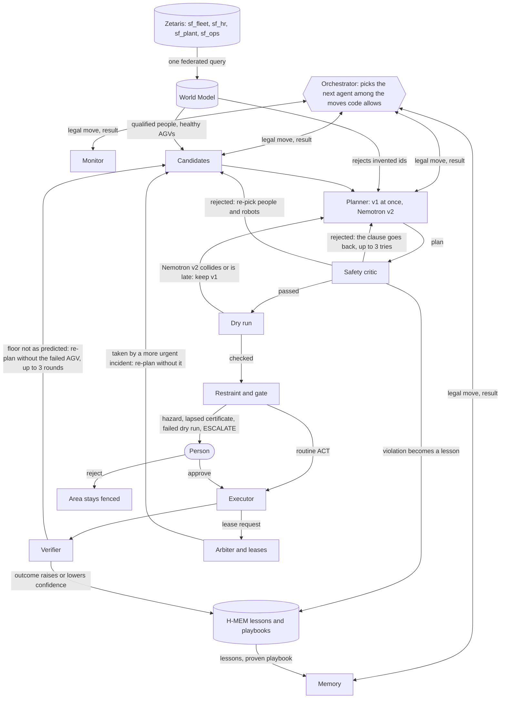
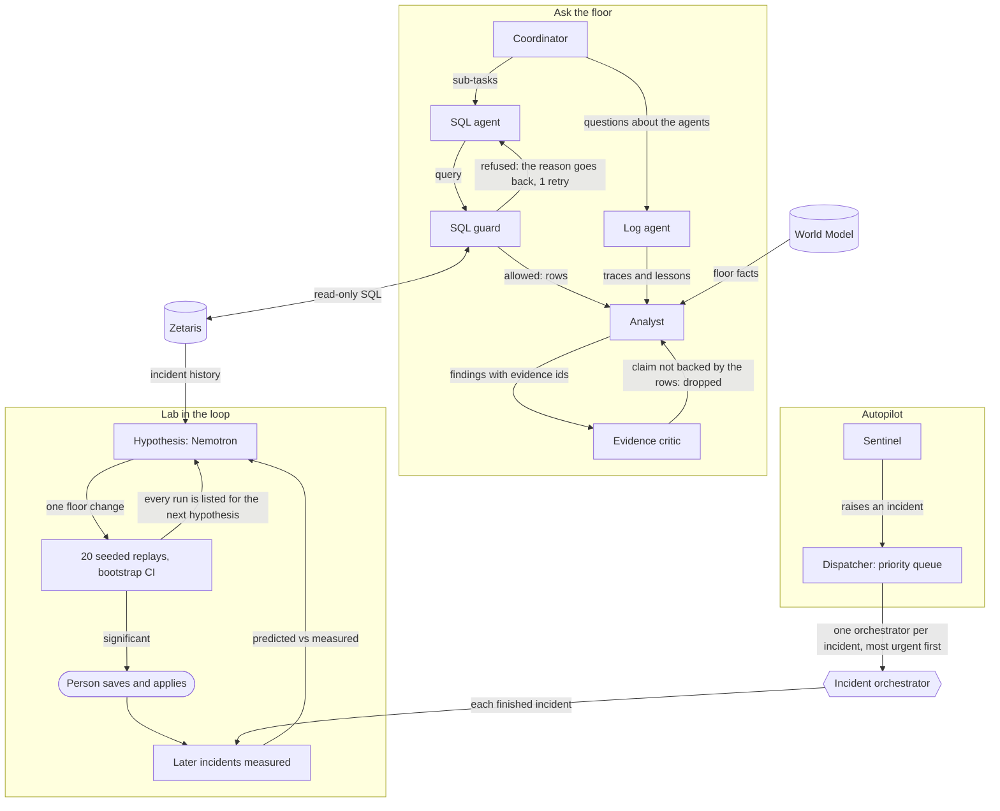

# Architecture

An index of how Shop-Floor OS is built. Part of the [README](../README.md#how-it-works).

Source: [architecture.html](architecture.html).

## How the agents work together
There is no fixed chain. In an incident the orchestrator ([`app/dynamic.py`](../app/dynamic.py)) picks the next agent among the
moves code allows, and agents send work back when a check fails. Each arrow is labelled with its condition.

The other three teams each run their own loop and meet the incident loop at the orchestrator, Zetaris and the
World Model:

## Where to read more
| Page | What it covers |
|---|---|
| [agents.md](agents.md) | every agent, the legal moves code allows, Ask the floor, Autopilot (Sentinel, dispatcher, leases), autonomy levels |
| [reliability.md](reliability.md) | retrieval without a vector database, context limits, failure handling, resilience, what broke during the build |
| [production-readiness.md](production-readiness.md) | what a real deployment would still need |
| [models-and-engines.md](models-and-engines.md) | which Nemotron model serves which role; how the Meterless engines are ported and tested |
| [data.md](data.md) | the fictional plant, what is real and synthetic, the planted patterns |
| [eval.md](eval.md), [chaos.md](chaos.md) | the safety evaluation and the 15 failure scenarios |
| [sponsors/](sponsors/README.md) | [Zetaris](sponsors/ZETARIS.md), [Meterless](sponsors/METERLESS.md), [NVIDIA](sponsors/NVIDIA.md), [Cursor](sponsors/CURSOR.md) |
| [USER_GUIDE.md](USER_GUIDE.md) | the web UI, tab by tab |
