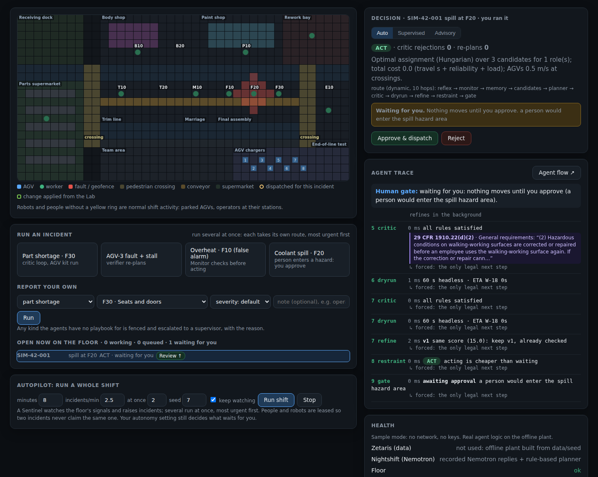
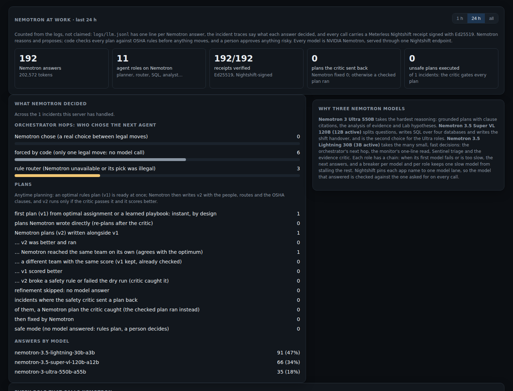
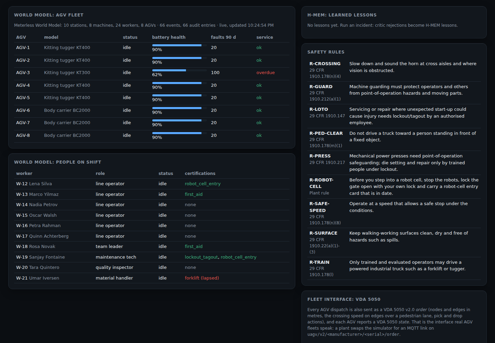

# User guide: the web UI

For a floor lead, shift supervisor or safety officer. Part of the [Shop-Floor OS README](../README.md).

Start it with `SAMPLE_MODE=true .venv/bin/python -m app.server` (no keys; the agents run on recorded Nemotron
replies and an offline copy of the plant) or live with `bash scripts/start_live.sh`, then open
http://127.0.0.1:8000. There are six tabs. Screenshots are from sample mode on 26 Oct 2026.

**The rule to remember:** the agents propose, code checks every plan against the safety rules and simulates it,
and nothing that sends a person into a hazard moves until you approve it.

## Live floor

**What you see.** The hall from above (one square is about 2 m): blue squares are AGVs, green dots are people,
olive columns are pedestrian crossings, red is a fault or a geofence, a yellow ring marks who and what was
dispatched for the current incident.

**What you do.**
- **Start an incident:** one of the four buttons (part shortage, AGV fault with a stall, a false-alarm overheat, a
  coolant spill), or *Report your own* with kind, station, severity and a free-text note.
- **Choose the autonomy level** in the *Decision* panel. *Auto* runs routine, checked plans at once and lets you
  roll them back; *Supervised* waits for you on every dispatch; *Advisory* only recommends.
- **Judge the decision.** When the panel says *Waiting for you*, read why (above: "a person would enter the spill
  hazard area") and press *Approve & dispatch* or *Reject*. Rejecting leaves the area fenced and nothing moves.
  Every judgement is logged with your name in `logs/approvals.jsonl`.
- **Read the agent trace** on the right: one line per agent, with the safety clause each check cited, and for each
  hop who chose it (`forced` means code allowed only one move).
- **Run a whole shift** under *Autopilot*: the Sentinel watches the floor's signals and raises incidents itself,
  several run at once, and anything risky lands in *Open now on the floor* with a *Review* button.

**For a safety officer:** the *Health* panel shows whether safe mode is on, the runtime safety checks (0 violations
expected), and whether the hash-chained journal is intact.

## Incidents

Every incident handled, newest first; click a row. The **agent flow** draws the route the orchestrator took:
numbered arrows in order, arrows going back where a check sent work back (the critic to the planner, the verifier
to candidates). Underneath, each hop's reason and who chose it: *Nemotron* (the router model), *rules* or *forced*.
Click a node for that agent's input, output, the model that answered and its latency. Use *compare* to put the
previous incident's route next to it.

**Re-check a decision without any model:** open `/api/verify/<incident id>` (for example
http://127.0.0.1:8000/api/verify/SIM-42-001). Code re-derives the decision from the saved trace and says CONFIRMED
or DIFFERS, check by check.

## Ask the floor

Ask a question in plain English, or press one of the three sample questions. A team of agents investigates: a
coordinator splits the question, a SQL agent queries the four plant databases through Zetaris (read-only, checked
by a SQL guard first), a log agent searches the agents' own history, an analyst writes findings, and an evidence
critic strikes out any claim the rows do not back (above: "26 false alarms" when the rows show 74).

- Every finding cites its evidence (E1, E2…). The *Evidence* panel shows the SQL and the rows behind it.
- *Asked earlier* keeps every answer. Ask the same question again and it shows what changed.
- Messages that are not questions are handled first, without a model: "someone is hurt" gets people-first
  instructions, a write ("delete all incidents") is refused, an action ("send AGV-3 to F30") is handed to the Live
  floor, and a report ("coolant spill at F20") pre-fills the report form.
- In sample mode only the three sample questions have recorded answers; other questions get a rule-based summary.

## Lab

Test a change to the floor against history before making it. *Run experiment*: the Lab proposes one change (a spill
kit at a station, or a loaded AGV waiting at one), re-walks every past incident of that kind with and without it,
runs 20 seeded replays and gives the change in mean time to clear with a 95% interval.

- **Save proposal to Zetaris** writes it to `sf_ops.experiments` through Zetaris.
- **Apply to the floor** puts the change on the map; every later incident of that kind is measured against the
  prediction under *Lab in the loop: predicted vs measured*. *Remove the change* takes it off.
- A red line under the buttons means the hypothesis came from a fixed rule, not Nemotron (always the case in
  sample mode).

## Nemotron at work

What the models actually did, counted from the logs: answers and tokens, receipts verified (Ed25519, signed by
Meterless Nightshift), plans the critic sent back and whether Nemotron fixed them, orchestrator hops chosen by
Nemotron vs forced by code, and which model answered. Choose the period (1 h, 24 h, all). The *Models* panel shows
each role's model chain and live breaker states.

## What the agents know

The facts the agents plan with, so you can check them: the AGV fleet and the people on shift from the World Model
(battery, faults, service dates, certificates and their expiry), the lessons H-MEM has learned and their
confidence, the safety rules the critic enforces, and the last VDA 5050 orders and states sent to the fleet.

## Watching from a terminal
`python run.py watch` in a second terminal prints one plain-English line per agent step, model call and human
judgement, for example `12:03:04 PLANNER  1.2s  Nemotron-Super attempt 2 -> send W-18; AGV-5->F30 1.0/0.5 m/s`.
